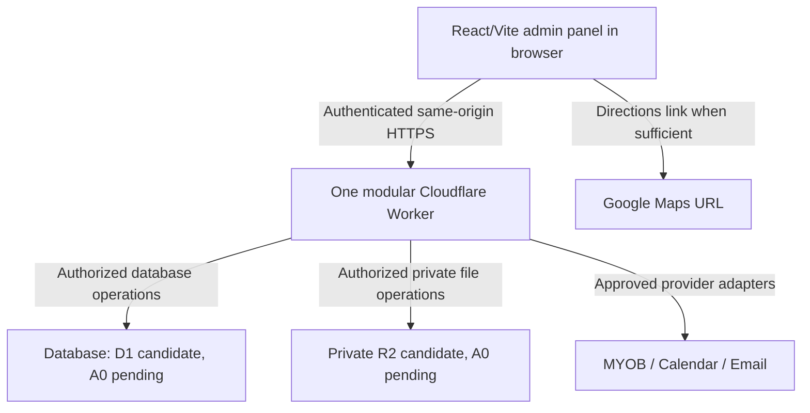

# CABMS Architecture

**Document status:** Review draft, fact-checked 28 October 2026 against local `dev` at `2b04f87bbb6dc4f81b65c6f2844d76488161e62d`. Updated 28 October 2026 with Rockson's formal approval of G01 architecture decisions and branch creation. Earlier PR/issue statements below are dated historical records, not a live status refresh.

**Current implementation:** G01 local Firebase/session, Worker/D1 and audited-settings integration over the preserved G00 React/Vite UI; security closure and real-browser acceptance remain incomplete.

**Hosting and delivery direction:** **ACCEPTED owner constraint, 27 October 2026** — Cloudflare, one repository, one coordinated build and one application deployment

**Future backend:** **ACCEPTED G01 architecture decisions, 28 October 2026** — One modular Cloudflare Worker, Cloudflare D1 relational database with Request-Correlation Nonce Pattern for atomic settings audit, Firebase Authentication (Spark tier + Google Sign-In) for pilot identity with server-side memberships, 1:1 legal issuer model per workspace (Super Admin only), and canonical API baseline (`/api/v1/workspaces/{workspace_id}/...` with RFC 9457 Problem Details and strong ETags/`If-Match`). Implementation branch `feat/g01-identity-workspaces` authorized.

This document preserves dated G00 evidence and records the owner-authorized G01 implementation on `feat/g01-identity-workspaces` / PR #17. Only the G01 decisions explicitly listed in section 14 are accepted; broader ADR topics remain proposed. Implementation authorization is distinct from final G01 acceptance, security-policy/migration approvals, publication, deployment and merge. FC-06 remains an absolute deployment hold.

## Historical G00 audit snapshot — 28 October 2026

- **VERIFIED locally:** `CABMS` (`main`) and `worktree/dev` (`dev`) are both at `2b04f87`; local history records the merge of PR #16. Current GitHub PR/issue status could not be refreshed. Merge, browser receipts and owner acceptance are separate facts.
- **VERIFIED implementation:** Ten bundled JSON fixtures feed `MockDataAdapter.getInitialBaseline()` through `seedData.ts`; views use `useCabms()`. Context retains business mutations. `getDataAdapter()` is unused by application/tests; `HttpDataAdapter` is an inert stub. This is a partial boundary, not a swappable live data layer.
- **VERIFIED audit findings:** Reminder calculation depends on host DST; dormant adapter paths permit incomplete appointments, missing customers, completion without forms, repeated enquiry conversion and incomplete form writes. These need focused fixes before adapter adoption, not an assumption that the mock enforces all production invariants.
- **Validation:** Project type-check and Vite build passed. Normal `npm test` failed at tsx Windows user-profile lookup before tests ran. An explicitly recorded alternate loader executed the unchanged suite: 169 tests, 167 passed, 0 failed, 2 skipped. Browser/pixel checks were not rerun.
- **FC-06:** Fresh local build output contains all five planning files in `dist/assets/aistudio`. Artifact inclusion is now verified; deployed exposure remains unknown. Existing deployment hold is unchanged.
- **REPORTED historical browser evidence:** Gate Q receipts at `30b4c72` and a later PR16 receipt are present under workspace `evidence/`; they were read, not independently replayed. Reconcile scenario/head coverage and owner acceptance instead of describing evidence as wholly absent or fully current.
- **Accepted planning direction — 28 October handoff:** G01 is real authentication → authorized workspace → persistent settings → atomic settings audit → frontend feedback and verification. Customer, enquiry, job and operational dashboard persistence stays in G02. Three existing workspaces only; no new-business provisioning. R2 and live provider connections are deferred. This initial planning snapshot preceded the later G01 execution authorization; current accepted decisions are limited to section 14 (§19.5).

Full current evidence: [Graphify/source audit](../../graphify-out/AUDIT-REPORT.md), [flow/data inventory](../../graphify-out/FLOW-AND-DATA-SOURCES.md), [planning fact-check](../../graphify-out/PLANNING-FACT-CHECK.md). Original planning drafts are preserved with the audit output.

## 1. Executive overview

CABMS is a trade-operations management demonstration for three named business brands: Solarcell, Gold Coast Smart Home Solutions and Gold Coast CCTV. The demo explores shared operational coordination while retaining per-business branding, work selection and issuer snapshots. These brand names are **not verified legal-entity names**.

The intended product journey is:

**Enquiry → Job → Quote → Acceptance → Schedule → Compliance → Completion → Invoice**

Some work can follow an approved direct-to-invoice path. A future system must keep business identity, accounting ownership, data access and legal issuer identity distinct. At the recorded G00 baseline the application was a synthetic browser demo. Current local G01 adds Firebase session handling and Worker/D1-backed settings; real-provider/browser acceptance is not established. MYOB, calendar, email and operational workflows remain simulated or deferred; no production deployment is claimed.

**ACCEPTED owner direction:** Preserve the React/Vite frontend and use one CABMS Git repository, one coordinated build and one Cloudflare application deployment with a modular Worker backend. The browser communicates with that Worker through authenticated same-origin application routes; a separate API server or API domain is not required. Design within Cloudflare wherever feasible.

**A0 scope qualification:** The G01 choices listed in section 14 are accepted for local implementation. Session revocation/account disabling, secure bootstrap, proposed additive migrations, private storage/retention, Australian data location, recovery and operating-cost evidence retain their outstanding decision/acceptance gates. Cloudflare selection does not approve every Cloudflare product or subscription. Any requirement that cannot be met within the selected direction must be reported for an owner decision.

## 2. Evidence, scope and status

### 2.1 Inspected revisions

| Evidence | Status and meaning |
|---|---|
| Current documentation worktree `dev` at `2b04f87bbb6dc4f81b65c6f2844d76488161e62d` | **VERIFIED 28 October local baseline.** Earlier `docs/branch-naming-plan` / `bbbdff6` references describe drafting history only. |
| GitHub PR [#14](https://github.com/PixelsWorker/CABMS/pull/14), rechecked 27 October 2026 | **VERIFIED at recheck:** open, unmerged, `feat/g00-full-review` into `dev`, 39 commits. Reviewed head: [`30b4c727dd459bc1891753a7ebe4e55135a6ef49`](https://github.com/PixelsWorker/CABMS/commit/30b4c727dd459bc1891753a7ebe4e55135a6ef49). 10 unresolved review threads remain on GitHub. This historical PR snapshot predates merged reference HEAD `2b04f87` and is not an acceptance or deployment record. |
| Source evidence | Current audit uses `2b04f87`; older explicitly pinned claims remain historical. Documentation edits are confined to the three planning files in `worktree/dev`. |
| Workspace and repository `AGENTS.md` | **VERIFIED locally.** The current parent instructions describe React/Vite and configured scripts/tests; earlier no-script/CLI claims are obsolete. Parent history guidance says reconciliation is complete, while repository guidance still mentions awaiting a plan. These governance discrepancies require reconciliation under issue #15; this task changes no instructions or Git history and infers no new execution authority. |
| `public/assets/aistudio/01-G00-GROUP-PLAN-FOR-REVIEW_02f12f1f.md` and `CABMS-G00-FULL-WORKFLOW-GAP-REPORT-2026-10-22_f5c4292c.md` | **VERIFIED present** as imported G00 planning references. Their proposals are not automatically accepted implementation facts. |
| `FULLSTACK-PROJECT-RULES.md`, `API-CONTRACT.md`, `TECH-RESEARCH.md`, and the referenced architecture packet | **VERIFIED UNAVAILABLE / 404 ON GITHUB; LOCAL ACCESS UNAVAILABLE:** Overseer inspection confirmed `API-CONTRACT.md` returned 404 at the PR head on GitHub. The similarly named contract in the Library belongs to CodeGuardian, not CABMS. The authoritative CABMS contract must be recovered or a replacement baseline approved by Rockson before Part 2 contracts are finalized (§10.1). Main Overseer review separately reports verifying the v0.2 ADR and roadmap crosswalk at the commit recorded in §14. |
| Rockson's 27 October 2026 documentation instruction | **ACCEPTED platform constraint:** one repository, coordinated build, Cloudflare deployment and modular Worker; same-origin secure routes and one canonical contract. Database, authentication, retention and data location still require A0 review. |
| Local Git preflight, 27 October 2026 | **VERIFIED:** the planning branch remains based at `bbbdff6`. GitHub PR #14 was separately rechecked at `30b4c72`; no claim is made that the planning baseline contains those newer G00 changes. |

The recorded G00 audit baseline is `2b04f87`; current G01 continues on the feature branch descended from that integration base. Entries dated 27 October and explicitly pinned to `bbbdff6`, `c00a179` or `30b4c72` retain historical provenance; they must not override the current audit snapshot. Current remote status and owner acceptance still require their own evidence.

### 2.2 Current status labels

- **VERIFIED** means directly inspected in a named local revision or current PR/issue record.
- **REPORTED** means stated in supplied material or a PR description but not independently demonstrated at the latest source revision.
- **PROPOSED** means a future design suggestion awaiting review.
- **ACCEPTED** is reserved for a decision with explicit approval evidence. The 27 October Cloudflare constraint and 28 October G01 planning handoff establish planning direction only; G01 implementation is owner-authorized on the existing feature branch; no final G01 acceptance, completed broader A0 ADR or deployment clearance is implied.
- **UNKNOWN** means evidence is missing.
- **BLOCKED** means a dependent decision or implementation cannot safely proceed until a named fact or approval is supplied.

### 2.3 Product and delivery evidence

**VERIFIED:** The G00 navigation defines ten destinations and four demo personas. Seed data represents three business brands, jobs, customers, templates, enquiries, quote states, and compliance forms. Context state is initialized in memory and reset through demo controls.

**VERIFIED:** The app entry and demo banner label the experience a prototype/demo and disclose no live integrations. G00 simulation does not establish production persistence, security, statutory validity or external-system completion.

**REPORTED:** PR #14 describes 131 passing tests and two skipped browser-related tests out of 133, plus successful type checking and a Vite build. The figures were not rerun at the latest PR head in this documentation task. Issue [#11](https://github.com/PixelsWorker/CABMS/issues/11) still records explicit acceptance and browser/device evidence as a gate.

**ACCEPTED:** Rockson selected the Cloudflare hosting/delivery constraint in §4. This is not acceptance of a complete backend architecture, A0 Part 1 or G00. G00 acceptance remains a separate gate.

### 2.4 Domain glossary and tenant naming

**Documentation convention / PROPOSED contract convention:** Use **workspace** for the CABMS tenant and `{api_prefix}/workspaces/{workspace_id}/...` for authenticated tenant URLs. Use this convention consistently in this draft; Part 2 must reconcile it with the existing contract before approval. Preserve accepted G00 labels and code values through an explicit mapping; this terminology change does not authorize renaming frontend types.

| Term or identifier | Meaning and boundary |
|---|---|
| Workspace / `workspace_id` | CABMS operating boundary for memberships and record ownership. The sole tenant noun in proposed API paths and serialized ownership keys. It is a selector, never authorization. |
| Company / operating business | Business-language description of the organization represented by a workspace; not a separate fifth CABMS tenant identifier. It does not establish a legal entity or accounting ledger. |
| Brand / G00 `BrandId`, `brandId`, `activeBrandId` | Existing UI identity and demo selector (`solarcell`, `smart_home`, `cctv`). Map to workspace identity explicitly; branding alone never grants membership. |
| Legal entity / `legal_entity_id` | Verified legal issuer/accounting owner. Workspace-to-entity cardinality requires business confirmation. |
| MYOB business/company-file/ledger identifier | External accounting resource ID, scoped to the verified MYOB product/API. Never substitute it for a CABMS `workspace_id` or `legal_entity_id`. |
| Integration connection / `integration_connection_id` | CABMS reference to a provider authorization/consent and protected credential set. A grant may authorize multiple external resources; store verified file-to-workspace mappings separately. |
| `owner_admin` / Admin | Existing internal role and its UI label; authority comes from current workspace membership and grants. |
| `job.quote` / quotation | Current nested G00 property; proposed normalized quote belongs to a job and its workspace. Preserve the six `acceptanceStatus` values. |
| `demoClock` / Clock | Current simulated time control; proposed injected Clock provides authoritative server instants in production and deterministic time in tests. |

Unqualified “business ID” is ambiguous and must not appear in new contracts. Use the glossary's specific CABMS or provider identifier.

## 3. Current frontend architecture — VERIFIED

### 3.1 Runtime and state

The current frontend is React and TypeScript, built and served by Vite. `index.html` loads `/src/main.tsx`; `src/App.tsx` wraps the application in `CabmsProvider`; `src/components/Navigation.tsx` defines the navigation destinations and demo persona filtering.

`src/context/CabmsContext.tsx` holds demo state and actions. `src/data/seedData.ts` supplies resettable synthetic records and scenarios. There is no durable server state in the inspected implementation. A browser-selected business or persona is a demo state value; it is not a trusted production identity or authorization credential.

Domain shapes and demo status unions live in `src/types/cabms.ts`; pure workflow and permission simulation helpers live in `src/utils/cabmsLogic.ts`; business-time helpers live in `src/utils/businessTime.ts`.

### 3.2 Ten navigation destinations

These are the current destination IDs and principal responsibilities. The precise visible labels vary by persona for the settings destination.

| Destination | Current demonstrated responsibility |
|---|---|
| Dashboard | Business overview, counts and operational summaries. |
| Jobs & Operations | Job selection, status, work-order details, assignments and consolidated operations. |
| Schedule & Calendar | Appointment dates/times, assignments and simulated reminders/calendar state. |
| Compliance & Forms | Job-linked JSA, electrical, smoke-alarm, TCA1 and TCA2 demonstration forms, validation and document previews. |
| Customers (MYOB) | Synthetic customer directory, duplicate warnings and simulated MYOB references/status. |
| Quotations & Terms | Job-linked quote details, terms snapshots, acceptance status and simulated follow-ups. |
| Communications & Reviews | Simulated certificate delivery, communication history and review-request status. |
| Website Enquiries | Synthetic enquiry review, dismissal and conversion-to-job flow. |
| Templates & Content | Quote, terms, compliance and communication template content/revisions. |
| System & Workspace Settings | Workspace profile and branding settings; a demo system/integration tab is shown to Super Admin. |

### 3.3 Businesses, personas and simulated access

The current brand IDs are `solarcell`, `smart_home` and `cctv`. The verified seed mapping is Solarcell → `brisbane`, Gold Coast Smart Home Solutions → `gold_coast`, and Gold Coast CCTV → `gold_coast`. The owner's stated production mapping is Brisbane City for Solarcell and Gold Coast for the other two; it remains **REPORTED / pending policy approval**, not a legal jurisdiction finding. See §6.3 for job-location exceptions and calendar provenance. SVGs are in `public/assets/branding/`; they establish presentation, not legal or accounting ownership.

The four current internal persona values are:

| Internal value | UI label | Current demo boundary |
|---|---|---|
| `super_admin` | Super Admin | Demo technical/system settings and privileged demo controls. |
| `owner_admin` | Admin | Workspace operations and workspace settings. |
| `office_staff` | Office Staff | Office coordination; demo guards restrict technical integration access and master-template editing/publishing. Other action access follows the tested demo guards, not a production policy. |
| `technician` | Technician | Assigned-work and field-form demonstrations with restricted office actions. |

`verifyPersonaAccess`, navigation visibility and context mutation guards are **client-side demo controls**. Issue [#5](https://github.com/PixelsWorker/CABMS/issues/5) reports a simulated signed-out action-guard gap and explicitly does not establish a live authentication exploit. Production must authenticate every request and enforce authorization in trusted server code.

### 3.4 Demonstrated workflows and boundaries

- Enquiry triage can represent conversion into a job.
- Jobs are associated with a demo brand and synthetic customer; job types capture form requirements and whether a direct-to-invoice route applies.
- Quotes are represented as properties of a job (`job.quote`), with six statuses: `DRAFT`, `SENT`, `ACCEPTED`, `EXPIRED`, `REVOKED`, `SUPERSEDED`.
- Quote scenario testing covers invalid, expired, revoked, superseded and already-accepted links. A demo quote preserves terms and issuer snapshots.
- Schedules, reminders, communications, MYOB status and review requests are simulated; none confirms a real provider write or delivery.
- Compliance samples cover JSA, Electrical, Smoke Alarm, TCA1 and TCA2. The code includes snapshot validation and frozen snapshot fields. The records remain in-memory demo evidence; they do not provide legal approval or infrastructure-level immutability.
- Direct-to-invoice behavior is represented in G00. Where approved, it may bypass quotation issuance; compliance and signing requirements remain independently determined by the job type and applicable approved rules. The current G00 example happens to require no forms, which is not a general production exemption.
- The latest inspected PR source has quote expiry after 14 elapsed calendar days and nominal 3-/7-business-day follow-ups. The follow-up engine uses a bounded 2026–2028 holiday table. Production policy, date coverage and authoritative holiday source remain **UNKNOWN**.

### 3.5 Appearance and accessibility

**VERIFIED in the latest PR snapshot:** `src/index.css` defines dark and high-visibility light/dark appearance behavior, brand styles and forced-colors support. Navigation includes a responsive drawer/sidebar, keyboard handling and labelled controls. Source and test commits cover focus behavior, settings tab state and contrast corrections.

**REPORTED / PENDING:** The PR description says real browser rendering was skipped. Automated markup or JSDOM tests do not substitute for browser/device, zoom, keyboard and full-workflow acceptance evidence. See issues [#4](https://github.com/PixelsWorker/CABMS/issues/4), [#8](https://github.com/PixelsWorker/CABMS/issues/8) and [#11](https://github.com/PixelsWorker/CABMS/issues/11).

### 3.6 Dependencies, scripts and outputs

At the `bbbdff6` local baseline, root `package.json` contains React, React DOM, Vite, TypeScript, Tailwind/Vite plugins, Express and demo/test packages. At PR head `c00a179`, the manifests also include Font Awesome Free Solid packages and both `package-lock.json` and `bun.lock` are present. The checked npm lock resolves React/React DOM 19.3.1, TypeScript 7.0.2, Vite 8.3.5, Tailwind CSS and `@tailwindcss/vite` 4.3.3, `@vitejs/plugin-react` 6.1.2, Motion 12.43.0, tsx 4.23.15 and jsdom 30.1.3. These are a dated lockfile snapshot, not a dependency-update recommendation. Issue #15 asks for tooling instructions to be reconciled; package-manager governance remains **UNRESOLVED**.

Root scripts include Vite `dev`, `build` and `preview`, TypeScript `lint`, `npm test`, and per-layer test scripts. The Vite config uses the repository root, React/Tailwind plugins, and an `@` alias. `tsconfig.json` uses bundler module resolution and currently excludes `dist`. The current browser build writes Vite output to root `dist/` by default. No backend build exists.

The user preference for one shared root npm setup is recorded below as a **PROPOSED design preference**. Preserve both lockfiles until package-manager governance is resolved. Compatibility with the selected backend runtime, dependency graph and build behavior must be assessed before adoption. `express` and `@google/genai` are manifest dependencies, not evidence of a working CABMS server or AI integration. Motion is installed, but no application-level TS/TSX import was found in the inspected PR source. The current `vite.config.ts` does not configure a Cloudflare Worker.

The current application navigation is hand-managed through `activeTab` and conditional rendering in `src/App.tsx`; no dedicated React Router setup was identified at PR head `c00a179`. Preserve that behavior unless an approved requirement justifies a focused change. The npm lock's jsdom 30.1.3 engine range requires Node `^22.22.2 || ^24.15.0 || >=26.0.0`; Vite 8 requires Node 20.19+ or 22.12+. Node 24 LTS is a reasonable future toolchain candidate only at a compatible patch level (at least 24.15 for this lockfile), subject to validation before any toolchain change.

## 4. Accepted repository/deployment direction and proposed layout

**ACCEPTED constraint — 27 October 2026:** One Git repository, one coordinated build, one Cloudflare application deployment and one modular Worker backend, with small same-origin routes for approved admin operations and one canonical frontend/backend contract. This replaces the earlier assumption of independently deployed frontend/API services. Each environment uses its own application deployment and isolated resources; this direction does not combine development and production data.

### 4.1 Source organization and coordinated build

Preserve the existing React/Vite frontend and its product behavior in `src/`. **A move to `frontend/` is not required** for the selected one-repository, coordinated Vite/Worker build or one Cloudflare application deployment. Do not rename `src/` merely for visual symmetry. A later source reorganization would need its own demonstrated benefit and approval.

The preferred design to assess is one CABMS Git repository with separate frontend and server-side modules:

```text
CABMS/
├── src/                   Existing React/Vite frontend; preserve in place
├── backend/               Proposed future Worker/domain modules
│   ├── modules/
│   ├── integrations/
│   ├── workers/           Background task modules in the same Worker service
│   └── tests/
├── contracts/             Proposed canonical frontend/Worker contract location
├── public/                Public frontend assets only
├── tests/                 Existing frontend test suite
├── package.json           Preferred shared root npm configuration
├── package-lock.json      Preserve existing npm lockfile
├── bun.lock               Preserve until package-manager policy is resolved
├── index.html
├── vite.config.ts
├── CHANGELOG.md
└── ARCHITECTURE.md
```

`src/` remains the current and preferred frontend source location; no source move is needed to share a repository or deployment. `backend/` and `contracts/` are **PROPOSED** future source locations only. Retain one root `package.json`, `package-lock.json` and dependency installation as the owner's preferred npm arrangement, subject to resolving existing Bun governance. Preserve `bun.lock` until that decision. Runtime and library compatibility must pass A0 review before packages or scripts change.

One root build command will coordinate browser and Worker compilation for one application deployment. Browser assets and server code remain separate outputs under the root build directory, with exact subdirectories chosen during A0; cleanup must stay within the approved output paths. Only the browser output is publicly served. Server code, secrets, private documents and the root `node_modules` directory must not be copied into public assets. Backend tests stay beside backend modules while existing frontend tests remain in place.

**VERIFIED platform capability:** Cloudflare's [React/Vite tutorial](https://developers.cloudflare.com/workers/vite-plugin/tutorial/) documents building client assets and Worker code together and deploying both through the same application deployment. It keeps client output in a separate `dist/client` subtree. That capability has not been implemented or tested in CABMS (source checked 27 October 2026).

### 4.2 Browser-to-Worker communication

The React admin panel runs in the user's browser. Private database/storage bindings and provider credentials belong to the Worker. The application therefore retains a secure HTTP communication layer even when both parts deploy together. Use the glossary's proposed tenant path, for example `{api_prefix}/workspaces/{workspace_id}/jobs`; Part 2 must reconcile and approve the actual route catalogue (§10.1).



| CABMS action | Proposed communication and ownership |
|---|---|
| View dashboards, customers and jobs | React requests same-origin resources; Worker filters by authenticated membership, workspace and permitted fields. |
| Create/edit a job or accept a quotation | Worker validates authorization or the approved public-acceptance token, domain rules, revision and transaction conditions before persistence. |
| Access approved compliance evidence | Worker authorizes access to private documents and permitted evidence attachments. G00 demonstrates synthetic form attachments; general job-photo uploads remain deferred pending approved scope (§8.3). |
| Synchronize MYOB customers or invoices | Worker uses the MYOB adapter, verified file/consent mapping and retry/reconciliation policy. |
| Add a calendar appointment | Worker uses the approved calendar adapter and records the external operation outcome. |
| Send reminders or certificates | Background modules in the Worker use the approved email adapter; delivery and failure state remain persistent. |

The proposed mutation path is: authenticate the staff session (or validate a narrowly scoped public acceptance credential), parse and validate input, resolve membership and record ownership, enforce action and field permissions, check domain state/concurrency, then perform the authorized transaction and, where durable dispatch is required, its outbox write. Reads apply the same authorization and disclosure boundaries without changing business records; permitted incidental side effects include access/audit records such as document-download metadata (§8.2). Return a safe response with a request identifier. Same-origin deployment does not provide authentication, CSRF protection or permissions by itself. Route handling must keep protected application operations out of static-asset/SPA fallback behavior; public quote acceptance and provider callbacks need their own narrowly scoped rules. Do not trust the active workspace selector sent by the browser.

**Public acceptance routing — PROPOSED, G03:** Reserve a dedicated customer-facing page such as `/quote-acceptance` on the same application, outside the staff `activeTab` shell and staff Access policy. Its minimal route entry may reuse the existing React app; a new router/framework or general customer portal is not implied. G00 currently simulates this experience within `QuotesAcceptanceView.tsx`; it has no verified production deep-link/token route. Part 2 must define direct navigation/refresh, invalid and expired links, back navigation, and narrowly scoped public API paths such as `{api_prefix}/public/quotes/{quote_id}/acceptances`. The Worker resolves workspace ownership from the authorized quote, never a customer-supplied tenant selector.

The token design must bind purpose, quote/revision and expiry, protect against replay, rate-limit attempts and prevent credential capture in logs/referrers/analytics. Choose and review a transport/exchange mechanism; a fragment-to-POST exchange is one candidate. GET, link previews and email scanners must never accept a quote or consume the acceptance action. Require explicit user confirmation and an authorized POST. Protect private responses from shared caching. Verify staff, public and callback boundaries on every enabled hostname, including preview and `workers.dev` routes; adding a public path must not bypass staff authorization.

### 4.3 Managed resources and background work

**PROPOSED:** HTTP, scheduled and queue handlers can be organized in the same Worker service; durable schedules, an outbox and Queues/Cron are candidates for reminders and integrations. These are event handlers and managed resources, not additional backend servers. See Cloudflare's [scheduled handler](https://developers.cloudflare.com/workers/runtime-apis/handlers/scheduled/) and [Queues JavaScript API](https://developers.cloudflare.com/queues/configuration/javascript-apis/) documentation, checked 27 October 2026. Workflows or additional Worker services require demonstrated need and an explicit scope decision.

Evaluate these guarantees in A0 now, but defer Queues/Cron resources and outbox implementation until G03 follow-ups or the first separately approved durable side effect. They are not default G01 scaffold dependencies. Database audit and local command idempotency can be needed earlier without requiring a queue. After G03, add only the processing required by each approved integration.

Use TypeScript on the Worker as the leading runtime candidate. Begin A0 evaluation with the standard Worker entry point and a small explicit route table; add a maintained router only if it reduces actual routing/validation complexity without expanding operational or security risk. Do not build a general-purpose router. Hono is optional, not selected. Any framework candidate must be checked at the exact version for Worker compatibility, maintenance and applicable security advisories before approval. Do not add Express just because it is already a repository dependency; verify runtime compatibility and a CABMS requirement first.

One application deployment does not make database migrations, storage configuration, queue bindings or provider setup part of an atomic release. A0 must define compatible changes, resource setup, recovery and rollback. The selected direction does not require a VPS or independently hosted API server; database, authentication and storage alternatives remain subject to their A0 gates.

No repository restructuring, package-manager change, new source directory, build change or deployment change is approved by this document.

## 5. Proposed backend component architecture — PROPOSED

Design these modules within the selected single Cloudflare Worker service and add only the background processing needed for durable scheduled work and integrations. A Worker service can execute concurrent invocations; it is not a singleton process or transaction lock. Do not add microservices, a second operational database or a workflow engine without a demonstrated requirement and approval.

**Timing labels:** “Required now” means necessary to the A0 foundation/G01 design, not permission to build. “Deferred” means defer implementation until the named approved group. “Conditional” requires a demonstrated requirement and approval. Module and record rows describe responsibilities, not a mandatory folder/table per noun.

| Module | Proposed ownership and responsibility | Requirement / destination | Timing |
|---|---|---|---|
| Identity and sessions | Trusted identities, session lifecycle, MFA/recovery integration through the identity boundary (§9). | Sign-in and protected operations | Required now: G01 design |
| Workspaces and authorization | Memberships, role grants and tenant/record/field checks. | All protected destinations | Required now: G01 design |
| Workspace profiles/settings | Operational identity/settings and controlled legal-issuer references. | System & Workspace Settings | Required now: two independently versioned G01 settings resources; legal relationships subject to A0 |
| Customers and accounting mappings | Customer ownership; external mapping only when MYOB scope is accepted. | Customers | Deferred: G02; accounting portion G06 |
| Enquiries and jobs | Enquiry review/conversion, customer match, job lifecycle, requirements and completion facts. One module owns website enquiries, avoiding duplicate intake ownership. | Website Enquiries; Jobs & Operations; Dashboard | Deferred: G02; new public website ingestion conditional |
| Quotations and acceptance | Issued revisions, terms/prices, expiry, public acceptance and reminder decisions. | Quotations & Terms | Deferred: G03 |
| Scheduling and technicians | Appointments, assignments, business time and approved calendar mapping. | Schedule & Calendar | Deferred: G04 |
| Compliance and documents | Form applicability, signed evidence, controlled amendments and private downloads. | Compliance & Forms | Deferred: G05; general job photos deferred as unapproved |
| MYOB adapter | Verified file/grant mappings, scoped accounting operations and reconciliation. | Customers; approved invoice workflows | Deferred: G06 |
| Calendar adapter | Event mapping, synchronization and provider failure handling. | Schedule & Calendar | Deferred: G04 |
| Communications and templates | Revisioned content and approved sending/delivery records. | Templates & Content; Communications & Reviews | Deferred: minimum quote/email portion G03, certificates G05, broader scope G07 |
| Audit and operational health | Durable authorization/privileged-action facts, safe logs/health and recovery visibility. Provider operation history arrives with its integration. | Necessary backend security/operations | Required now: G01 baseline; expanded readiness G08 |
| Clock and holiday boundaries | Injected time and versioned holiday lookup shared by domain decisions; no new service implied. | Quote timing; scheduling; weekly dashboard metric | Required now: boundary design; implementations G02/G03/G04 as needed |

These are proposed internal module boundaries within the same Worker deployment. They do not create a server, separate API domain or independently deployed Worker per row.

### 5.1 System logging and audit — PROPOSED

Keep four distinct concerns on one approved logging/audit design: (1) structured Worker application logs for request IDs, errors, latency, authentication failures and operational outcomes; (2) durable business/security audit records for authorized changes, with `settings_audit_events` as the G01 settings-specific record; (3) provider operation/status history added with G03–G07 integrations; and (4) safe health/diagnostic checks. Do not create a competing generic audit store: any later `audit_events` concept must be reconciled with the same audit model, access controls and retention policy.

G01 includes the minimum structured Worker logging and durable atomic settings audit needed to verify real frontend-to-Worker behavior. G02–G07 extend logs and audit records with each feature's sensitive changes and real integration outcomes. G08 is the proposed group for expanded observability, alerting and long-term retention. R2 archival of system logs is optional and separately approved; it is not required for G01 logging tests. If approved, implement and test export, retrieval, access control, redaction, failure and recovery in its authorized group. System-log archives are distinct from signed compliance evidence storage (§8.2).

All logs must use request correlation and safe structured fields, exclude credentials/tokens and avoid unnecessary personal or legal data. Define access, redaction, retention and deletion with the approved privacy policy. Never treat an application log as the durable business audit record. Use controlled event labels, defined severity levels, server UTC timestamps and request correlation. Enforce field allowlists and redaction before serialization. Acceptance must test success/failure log schemas and prove credentials, tokens and disallowed sensitive values are absent from messages, fields, exceptions and nested payloads.

## 6. Business flow and domain invariants

### 6.1 Main path and exceptions

Keep the normal journey readable:

**Enquiry → Job → Quote → Acceptance → Schedule → Compliance → Completion → Invoice**

Preserve direct-to-invoice jobs where quotation issuance may be bypassed under approved rules. Determine compliance applicability and signing requirements separately from the quote path; bypassing a quote never implies a compliance exemption. Model decline, office revocation, expiry, superseding, cancellation, failed integration, revisit and recovery paths explicitly.

The following status vocabularies are **VERIFIED in [G00 types at c00a179](https://github.com/PixelsWorker/CABMS/blob/c00a1796b0867d8952fdfa412889393ddcc79096/src/types/cabms.ts)**. They are separate lifecycles, not one universal status field or automatically approved transition graphs.

| Record | Existing status values | Part 2 transition obligation |
|---|---|---|
| Job | `NEW`, `SCHEDULED`, `IN_PROGRESS`, `NEEDS_REVISIT`, `COMPLETED`, `CANCELLED` | Define scheduling prerequisites, cancellation, revisit/reopening and completion evidence; preserve vocabulary unless compatibility changes are approved. |
| Website enquiry | `PENDING_REVIEW`, `CONVERTED_TO_JOB`, `DISMISSED` | Define review-to-conversion/dismissal, reopening policy and repeat requests; conversion must link to exactly one resulting job under the approved rule. |
| Quote | `DRAFT`, `SENT`, `ACCEPTED`, `EXPIRED`, `REVOKED`, `SUPERSEDED` | Define issuance, immutable revisions, acceptance/expiry/revocation races and terminal reminder suppression. |
| Appointment | `UNSCHEDULED`, `SCHEDULED`, `RESCHEDULED`, `CANCELLED` | Separate appointment changes from job completion/cancellation; define assignment and timing constraints. |
| Invoice | `DRAFT`, `SENT_TO_MYOB`, `UNPAID`, `PAID`, `RECONCILIATION_REQUIRED` | Preserve demo vocabulary as input; verify what provider evidence makes each production transition true. |

**PROPOSED invariant:** Enquiry conversion atomically records the created job, source enquiry link and conversion outcome; repeated conversion returns the established result or a documented conflict rather than creating another job. Job completion must check applicable required forms/signatures independently of quotation bypass. Part 2 must resolve cancellation/revisit effects on appointments, invoices and signed history before G02/G04/G05 contracts are accepted.

### 6.2 Proposed invariants

- Every quote belongs to an existing job, customer and permitted workspace. The current UI's nested `job.quote` need not dictate relational denormalization.
- Acceptance stores the exact quote and Terms revision, acceptance instant, acceptor identity and evidence required by the approved legal/product policy.
- Workspace-scoped records have consistent ownership enforced by relationships and server authorization, not only by filtering the interface.
- The existing six quote status values are preserved unless a specific compatibility change is approved.
- `DRAFT`, `SENT`, `ACCEPTED`, `EXPIRED`, `REVOKED` and `SUPERSEDED` transitions, terminal behavior and reminder cancellation are specified before implementation.
- The demo's 14-calendar-day expiry and 3-/7-business-day follow-ups are **VERIFIED demo behavior, PROPOSED production policy only**. Owner approval is required.
- Monetary amounts in the current TypeScript demo are JavaScript numbers in display currency. A future backend should represent AUD monetary values as integer cents and validate conversions; this is not an existing storage invariant.
- Signed historical evidence is not overwritten. Corrections create a controlled amendment/new revision with actor, timestamp, reason and linkage to the superseded record.
- Unique constraints protect local business identities, issuance/acceptance records and reminder stages. Idempotency keys protect eligible commands. Neither guarantees exactly-once outcomes from a remote system.
- A remote write with uncertain outcome enters reconciliation before another potentially duplicating attempt.
- **VERIFIED demo metric:** `DashboardView.tsx` at c00a179 counts the selected brand's jobs with `status === 'COMPLETED'` and `isInBusinessWeek(completedAt, demoClock)`. Issue [#7](https://github.com/PixelsWorker/CABMS/issues/7) is historical defect/acceptance evidence. G02 must formalize workspace filters, business-week boundaries, missing timestamps, reopening and repeated completion; production policy remains pending approval.

### 6.3 Time, expiry and concurrency

The current G00 helper uses Australia/Brisbane for displayed and synthetic business time, with a finite hard-coded holiday set for Brisbane and Gold Coast. The per-brand mapping is recorded in §3.3 and verified in [seedData.ts at c00a179](https://github.com/PixelsWorker/CABMS/blob/c00a1796b0867d8952fdfa412889393ddcc79096/src/data/seedData.ts). The owner's stated Brisbane City/Gold Coast policy is pending approval; confirm whether workspace region or job-site region governs each calculation, including jobs outside the normal region. Production requires maintained authoritative calendar evidence, version/effective dates and an owner for updates. Define behavior when a calendar year/region is unavailable; do not silently treat missing data as a business day. Seed addresses and 2026–2028 coverage are not proof of production legal jurisdiction.

**Proposed quote reminder eligibility:**

```text
dueAt <= now && now < expiresAt && quoteStateIsEligible
```

Use authoritative server time for production, injected clocks in tests, and a documented UTC persistence policy. Keep date-only calendar values distinct from instants. Define expiry equality behavior, transaction boundaries and atomic transitions for acceptance versus expiry/revocation, duplicate acceptance, quote revision versus in-flight acceptance, and reminder dispatch versus cancellation.

Where an approved command requires durable dispatch, the selected database must atomically update CABMS state and insert the local outbox intent. Ordinary operations do not acquire an outbox dependency merely by being writes. Publishing an outbox record to Queues or an external provider is separate and requires retry/deduplication. One Worker deployment does not make database and queue writes atomic. An application transaction cannot roll back a message accepted by an email provider or a financial write that already reached MYOB. Document provider idempotency support, uncertain outcomes, retry limits, rate limits and reconciliation; do not claim exactly-once external delivery.

**D1 concurrency and transaction safety gate — A0-ADR-01/05:** Cloudflare documents `D1Database.batch()` as an atomic ordered SQL batch that executes inside a single SQLite transaction and rolls back on a statement failure. However, D1 does *not* support interactive client-side transactions that branch dynamically based on intermediate row counts within a single batch, and an `UPDATE` affecting zero rows does *not* trigger a SQL error.

Furthermore, naive conditional subqueries like `WHERE EXISTS (SELECT 1 FROM quotes WHERE id = ? AND status = 'ACCEPTED')` fail under concurrency: if concurrent Request A transitioned the quote a millisecond earlier, Request B's `UPDATE` affects zero rows, yet Request B's `INSERT ... WHERE EXISTS(status='ACCEPTED')` evaluates to TRUE, causing Request B to spuriously insert duplicate acceptance records. A separate sequential `UPDATE` followed by an `INSERT` across separate network calls is equally flawed because it is not atomic across Worker crashes and allows race windows.

**PENDING EXECUTABLE PROOF:** A0-ADR-01/05 carries forward the **Request-Correlation Nonce Pattern** as a candidate within an atomic batch. The following quotation SQL is illustrative research, not an approved or proved implementation. Settings update/audit invariants additionally require the proof in §19.5:
1. **Unique Transition Nonce:** The Worker generates a cryptographically random nonce (`req_nonce = crypto.randomUUID()`) for the specific acceptance command.
2. **Atomic Batch Statements:**
   ```sql
   -- Statement 1: Conditional state transition capturing this specific request's nonce
   UPDATE quotes
   SET status = 'ACCEPTED', transition_nonce = ?, accepted_at = ?, accepted_by = ?, version = version + 1
   WHERE id = ? AND status = 'SENT' AND expires_at > ?;

   -- Statement 2: Guarded insertion matching ONLY this specific request's nonce
   INSERT INTO quote_acceptances (quote_id, transition_nonce, accepted_at, evidence_digest)
   SELECT id, transition_nonce, accepted_at, ?
   FROM quotes
   WHERE id = ? AND transition_nonce = ?;
   ```
   *Intended specific-request guard, pending executable proof:* If Statement 1 affects zero rows (e.g., because the quote expired, was revoked, or was already accepted by Request A), `quotes.transition_nonce` is NOT updated to Request B's nonce. Consequently, Statement 2 selects zero rows and inserts nothing.
3. **Database Schema Invariant:** `quote_acceptances` defines a `UNIQUE(quote_id)` constraint, guaranteeing that SQLite physically rejects any duplicate acceptance attempt.
4. **Post-batch result classification:** Inspecting `meta.changes` after a committed batch cannot roll it back. Zero-row updates are not SQL failures. The candidate must prove all-or-nothing mutation/evidence behavior inside the transaction using a supported guard, constraint/trigger or equivalent mechanism that fails atomically on missing required evidence. Only after this proof may the Worker classify success, precondition failure or domain failure using §10.4; do not infer success from the update count alone. Expiry does not automatically mean the quote resource is gone.

Executable proof test suites modeling race conditions (simultaneous acceptances, acceptance at exact expiry boundary, duplicate idempotency keys, and outbox failure recovery) are mandatory before D1 is finalized. [D1 batch semantics](https://developers.cloudflare.com/d1/worker-api/d1-database/#batch), checked 27 October 2026.

A0 must supply a reasoned D1-specific design for all §6.3 races, the authoritative acceptance-time/expiry equality rule, stale reads, idempotent replay and rollback after a failed statement. Define whether the acceptance instant is evaluated by the write or by a trusted timestamp captured earlier and how delay is bounded; a stale pre-check must not authorize expired acceptance. Replica/session read consistency must not be presented as a write lock. Executable proof tests require separately authorized validation scope; they are required before dependent implementation is accepted. If evidence is insufficient, D1 remains **BLOCKED for final ADR acceptance** and alternatives require an owner decision. Do not install a different database silently.

### 6.4 Financial calculation policy — PROPOSED / owner confirmation required

Keep stored AUD totals in integer cents. Define unit-price/quantity precision, discounts, tax codes, GST-inclusive versus exclusive input and decimal calculation rules separately; integer totals alone do not define tax arithmetic. Use decimal or integer-scaled arithmetic, not binary floating-point money calculations.

The starting candidate is explicit per-line net/tax/gross amounts, line tax rounded to cents with a documented rounding mode, and invoice totals derived from those line amounts. Line-level versus invoice-level rounding, midpoint behavior, negative adjustments, exemptions and MYOB tax-code mappings remain **UNKNOWN** until the business/accounting owner confirms the policy against the actual ledger. Part 2 must record examples for fractional quantities and half-cent boundaries and reconcile CABMS totals to MYOB without silently changing accepted quotes. Do not assume a universal GST rate or tax treatment from demo values. Resolve before G03 pricing-contract acceptance and G06 accounting integration.

## 7. Identity and authorization

### 7.1 Current versus proposed

**Current / VERIFIED:** Personas and session state are simulated in React context. A UI route and client-side guard can demonstrate access behavior but cannot protect a server or data store.

**Proposed / A0 decision required:** Use a maintained identity service or a deliberately managed authentication component selected in Part 1. Compare MFA, session renewal/revocation, recovery, rate limiting and operator responsibilities. Store identity-provider subject IDs, not passwords in CABMS. Require MFA for privileged roles if selected by the approved policy.

Cloudflare Access is a candidate staff-entry control, not an approved complete CABMS identity/permission design. If selected, validate its signed identity tokens in the Worker and map trusted identities to CABMS memberships and roles. Public customer acceptance must not require staff membership. See [Access application tokens](https://developers.cloudflare.com/cloudflare-one/access-controls/applications/http-apps/authorization-cookie/application-token/), checked 27 October 2026.

### 7.2 Authorization model

Part 1 selects an isolation strategy; Part 2 defines the complete role × workspace × resource × action × field matrix. Each authenticated request must resolve the user's active account, workspace membership, resource ownership and permitted action. A workspace ID in a URL or active selector is an identifier, never proof of permission.

The server must validate all protected reads and writes, including nested resources and document downloads. Apply the same rules in API handlers, application services, background workers and database access patterns. Return concealed `404` where disclosure of a foreign record would leak its existence; otherwise use a safe `403`.

| Role | Proposed starting boundary; final matrix pending |
|---|---|
| Super Admin | Cross-workspace technical operations only where specifically approved; legal and financial actions remain separately controlled and audited. |
| Admin (`owner_admin`) | Operational management within memberships, plus explicitly granted workspace settings. No implied access to provider secrets. |
| Office Staff | Permitted customer, enquiry, quote and scheduling operations within memberships; sensitive legal, integration and field controls require explicit grants. |
| Technician | Assigned-job and permitted compliance actions; no broad customer directory, financial writes or unassigned-job access without approved policy. |

Staff may belong to multiple workspaces. Shared customers and consolidated dashboards require explicit share/query rules so that aggregation cannot expose another workspace's records. Technician assignment is a resource-level constraint, not merely a hidden menu item.

The current destination's two-tab settings hub is a G00 UI behavior. The proposed production boundary separates workspace operational/legal settings from system integration controls and secrets. The accepted G01 planning boundary reserves Save Legal Details for Super Admin only. Final legal-issuer relationships, membership rules and the complete server-side field matrix remain subject to A0 approval; operational settings access does not imply legal-write authority (§19.5).

## 8. Proposed persistence and document evidence — PROPOSED

Cloudflare is the selected hosting direction. **D1 is a database candidate and private R2 is a document-storage candidate; neither detailed design is accepted.** A0 must establish relational constraints, workspace isolation, atomic quote/outbox transitions, concurrency, recovery, operating cost and data location. [D1 uses SQLite semantics](https://developers.cloudflare.com/d1/) (checked 27 October 2026); do not carry PostgreSQL-specific transaction or isolation assumptions into its design. A managed PostgreSQL alternative may be researched if D1 fails a requirement, with any departure from Cloudflare-native resources reported for owner approval. There is no implemented PostgreSQL backend to replace.

### 8.1 Candidate records

Candidate normalized records include:

| Candidate record or concept | Key relationships and purpose | Timing / scope condition |
|---|---|---|
| `users`, external identity mappings, `workspaces`, `workspace_memberships` | Stable internal user/workspace IDs; provider-scoped issuer/subject mapping and server-owned memberships. | Required now: G01 design; identity provider and membership policy require A0. |
| `workspace_settings` | Workspace-owned trading name, approved operational details, accent and appearance preferences; independent version. | G01; Save Workspace Settings (§19.5). |
| `role_grant` | Optional representation for approved scoped grants beyond membership role fields. | Conditional: do not add configurable RBAC tables if the four fixed roles and approved fields suffice. |
| `legal_issuers` | Legal issuer, ABN/licences and explicit workspace-to-issuer relationship; independently versioned from workspace settings. | G01 legal details; Super Admin only; cardinality/shared-issuer authority requires A0. |
| `customer` | Workspace-owned customer identity. | Deferred: G02. |
| `customer_workspace_access` | Explicit customer sharing where business policy permits it. | Conditional: G02 sharing approval; private per-workspace ownership is the safe fallback. |
| `enquiry`, `job`, `job_type_revision` | Intake, originating enquiry, workspace ownership and frozen applicable job requirements. | Deferred: G02; a separate revision table is conditional on the approved history design. |
| `quote`, `quote_revision`, `acceptance` | Issued revisions, terms, expiry and acceptance evidence. | Deferred: G03. |
| Quote follow-up `reminder` | Unique quote/revision/stage and due/dispatch facts. | Deferred: G03; separate from appointment reminders. |
| `appointment`, `technician_assignment` | Scheduling and assignment facts. | Deferred: G04; separate assignment table only if multiplicity/history requires it. |
| `document_record`, `document_revision`, `evidence_object` | Ownership, signed bytes/digest, issuer/signer evidence and amendments. | Deferred: G03 minimum frozen quotation artifact if needed; compliance evidence G05; choose minimal representation in Part 2. |
| `message`, `delivery_attempt` | Approved recipient/channel and send/reconciliation facts. | Deferred: minimum follow-up delivery G03, certificate delivery G05, broader communications G07. |
| `integration_connections` | Account-level or workspace-level ownership with explicit owner reference/scope; status metadata and deterministic fakes in G01. | No G01 provider connection or credential capture. Shared MYOB file remains a demo assumption pending ledger ownership confirmation. |
| `external_mapping`, `provider_operation` | External resource mapping and uncertain-write history. | Deferred to the approved provider group; no live MYOB/Email/Calendar in G01. |
| `settings_audit_events` | Durable resource-specific versioned settings changes, approved field before/after values, actor/workspace/UTC/request/outcome and privacy policy. | Required G01 atomic write; secure verification; new Settings History screen deferred (§19.5). |
| Other `audit_event` concepts | Privileged-operation evidence outside settings. | Extend only with each approved group; reuse conventions. |
| `idempotency_record` | Scoped request identity, payload fingerprint and safe replay result. | Conditional from first retry-sensitive G01/G02 command; define minimal storage and retention. |
| `outbox_event` | Atomic local intent for a durable external side effect. | Deferred: G03 or first separately approved durable-dispatch requirement; no automatic G01 queue/outbox installation. |

Part 2 must define actual keys, foreign keys, checks, transaction boundaries, retention, tenant constraints and indexes. This list is not a committed schema.

### 8.2 Compliance documents and immutability

The G00 demo includes JSA, Electrical, Smoke Alarm, TCA1 and TCA2 structures, signed fields, snapshots and validation. Official [WorkSafe Queensland electrical safety guidance](https://www.worksafe.qld.gov.au/laws-and-compliance/electrical-safety-laws/issuing-certificates-of-compliance) specifies a **five-year minimum retention period** from the date of issue for electrical certificates of compliance/safety and testing. Statutory retention periods for JSA, Smoke Alarm, TCA1, TCA2 and customer acknowledgement records remain **UNKNOWN** and must be confirmed with qualified legal/compliance advice and the business owner; blanket seven-year retention assumptions are unsupported.

The proposed evidence system combines private object storage with relational metadata. It should preserve the exact issued bytes, content digest, object version, form schema/template version, issuer details, signer identity/evidence, signing time, job/workspace ownership and amendment history. Downloads use authorization checks and short-lived access grants; credentials and acceptance tokens do not enter logs.

The threat model must address application users, service accounts, database administrators, storage administrators and infrastructure operators. Separate prevention, tamper detection, retention expiry, backup restoration and residual privileged-access risk. Versioning or a hash alone detects some changes but does not prevent an administrator from replacing both content and metadata. Stronger immutability/retention controls depend on provider capabilities and legal policy. No technical control by itself establishes legal validity.

For the R2 candidate, bucket-lock rules can block object overwrites/deletion while active, but authorized administrators can remove the rules. Define explicit evidence revision keys and metadata without assuming automatic object version history or administrator-proof retention. Assess separate privileges, tamper detection and independent recovery against the legal policy. [R2 bucket locks](https://developers.cloudflare.com/r2/buckets/bucket-locks/), checked 27 October 2026.

### 8.3 PDF generation, attachments and persistence boundaries

**VERIFIED G00:** [ComplianceFormsView.tsx at c00a179](https://github.com/PixelsWorker/CABMS/blob/c00a1796b0867d8952fdfa412889393ddcc79096/src/views/ComplianceFormsView.tsx) has a synthetic Field Evidence Photos & Attachments Library, a branded preview and `window.print()` for browser print/save-PDF. That establishes a G00 destination for sample form attachments; it does not establish accepted general-purpose job uploads, a server PDF renderer or durable signed evidence.

**PROPOSED:** Treat browser printing as a convenience copy. A0-ADR-01/04 must select an authoritative artifact-generation approach: a Worker-compatible PDF library is the initial candidate; browser-supplied bytes require validation and trusted binding to the frozen record; Browser Rendering or an external renderer is conditional on a demonstrated requirement and explicit resource/cost approval. Check fonts, layout, images, bundle size, CPU/memory and signing requirements against [Worker limits](https://developers.cloudflare.com/workers/platform/limits/). Do not assume a Node PDF package or headless browser runs inside an ordinary Worker. Decide before G03 issued artifacts and G05 certificate contracts are accepted.

Document bytes and relational metadata do not share one transaction across D1 and R2. Part 2 must define generation/upload, validation, digest verification and finalization, including recovery after either store fails, orphan cleanup and no download before ownership/finalization checks. Preserve signed bytes; regeneration creates a revision, never an overwrite. Approved uploads require byte/size/media validation, safe filenames/download headers and a decision on active-content/malware controls. General job-photo uploads remain **DEFERRED**; any production version of the demonstrated compliance attachment journey needs an approved G05 requirement, limits, retention and permissions.

## 9. External systems and integration boundaries — PROPOSED

Keep provider-specific request/response objects inside adapters. Domain logic should call provider-neutral interfaces and deterministic fakes. Use the single identifier glossary in §2.4; all tenant-scoped URL examples use `workspaces`, and provider business/file identifiers remain external mappings.

Do not infer a one-brand/one-legal-entity/one-ledger/one-grant relationship. Current MYOB documentation describes OAuth, granular scopes and company-file business identifiers; its details differ by MYOB product and API generation. Verify the actual product, files, admin consent, required scopes and permitted customer/invoice/payment operations against dated official docs and an approved sandbox. **UNKNOWN:** CABMS's actual MYOB product, ledger count, issuer mapping and administrator.

Proposed adapters:

- **Identity / Access / IdP:** validate provider tokens, issuer/audience/expiry and revocation/session rules at the trust boundary; return a normalized trusted principal to CABMS authorization. Keep vendor headers, JWT payloads and recovery/MFA transports outside domain decisions. CABMS resolves current memberships rather than trusting a browser-supplied role. Provide deterministic identity fakes for tests; use supported identity libraries, not homegrown token verification.
- **Holiday source:** expose a versioned region/date calendar lookup with source/effective-date and coverage information. A reviewed static dataset may be sufficient; a new network service is not required by this boundary. Define missing-region/year and refresh/failure behavior; tests use fixed calendars.
- **Clock:** inject a time-provider interface into decisions and workers. Production supplies authoritative server instants; tests use a deterministic clock. Avoid hidden `Date.now()` calls inside domain decisions. This is an internal dependency boundary, not an external service.
- **MYOB Business:** scoped OAuth, file mapping, customer/invoice reads and writes only as approved, operation IDs, provider idempotency assessment and uncertain-write reconciliation.
- **Calendar:** provider event mapping, create/update/cancel outcomes, timezone handling and duplicate reconciliation.
- **Email:** approved templates, send attempts, provider acceptance versus final delivery distinction, rate limits and suppression. Keep transport behind an adapter; evaluate an HTTPS provider interface or the Cloudflare Email Service Worker binding. SMTP is a protocol, not a requirement for a CABMS API route. Workers block outbound port 25 by default, so do not assume an existing SMTP library/transport works unchanged. Cloudflare Email Sending is beta and requires an explicit production-risk decision. Sources: [TCP socket restrictions](https://developers.cloudflare.com/workers/runtime-apis/tcp-sockets/) and [Email Service](https://developers.cloudflare.com/email-service/), checked 27 October 2026.
- **Maps/Reviews:** add an integration only where an approved journey requires it. Directions can use an ordinary Google Maps URL, which does not require an API key; do not add a Maps API or backend proxy solely for that action. [Google Maps URLs](https://developers.google.com/maps/documentation/urls/get-started), checked 27 October 2026. Additional Maps/Reviews capabilities remain scoped decisions.

No credentials, sandbox authorization, API writes or real integrations are part of this documentation task.

For any approved callback/webhook, Part 2 must define provider-specific authenticity, replay/deduplication and resource mapping before changing CABMS state. OAuth initiation/callbacks must bind the initiating authorized staff session to the intended connection; serialize token refresh/replacement where concurrent invocations can race. Never accept a callback's workspace/file selection without validating the stored connection mapping. These are requirements on approved integrations, not permission to add speculative webhook endpoints.

## 10. Canonical API principles — PROPOSED

### 10.1 Reconcile the existing contract first

`API-CONTRACT.md` was **VERIFIED 404 ON GITHUB during Overseer inspection**, and is locally unavailable in this workspace. The similarly named contract in the Library belongs to CodeGuardian, not CABMS. Before defining the canonical resource catalogue, Part 2 must attempt to recover the authentic predecessor from project archives or obtain Rockson's formal approval for an explicit replacement baseline. Do not maintain competing or fragmented specifications. Inaccessibility blocks final API-governance approval; independent research may continue conditionally.

**Unavailable-source fallback:** If the authentic CABMS contract cannot be recovered, mark the affected Part 2 contract catalogue and final A0-ADR-06 approval **BLOCKED** and escalate to Rockson through Main Overseer. Record the missing source/revision, retrieval attempts and affected decisions. The owner must supply the authoritative material or explicitly approve a replacement-baseline process identifying one new source of truth and how the unavailable predecessor will be retired/reconciled if recovered. The provider cannot declare the old contract void or approve its own replacement without owner sign-off.

**Contract Convention Reconciliation (Frontend Part 2 JSON Proposal vs Architecture Plan):**
Historical inspection, reconfirmed in `worktree/dev/src/services/` at `2b04f87`, found stub URL labels and unapproved DTO declarations using `/api/v1/brands`, response envelopes (`{ data: T, meta: { ... } }`), page-based pagination (`{ page, limit, total_records }`), and custom error classes. No live routes exist and `ApiResponse<T>` is unused. The declarations differ from the architecture plan's proposed conventions:
- **Tenant routing:** `{api_prefix}/workspaces/{workspace_id}/...` tenant hierarchy vs `/api/v1/brands` client-brand selector.
- **Errors:** Canonical RFC 9457 Problem Details (`{ type, title, status, detail, instance, code, retryable, request_id, errors }`) vs custom client envelopes.
- **Pagination:** Cursor-based pagination (`limit`, `starting_after`/`cursor`, `next_cursor`) for growing operational records vs offset/page-based pagination.
- **Envelopes:** Direct resource payloads vs `{ data: T }` envelopes.

**Formal Frontend/Backend Handoff Rule:** Frontend and backend architects must not independently choose incompatible APIs. The in-memory mock adapter (`src/services/mockAdapter.ts`) is preserved now strictly for local G00 demo and fixture evaluation. Historical G00 boundary: `src/services/httpAdapter.ts` remains dormant. Authorized G01 uses `src/services/g01Client.ts` and the accepted `/api/v1` baseline; this does not authorize G02+ integration or deployment.

The following are **PROPOSED design conventions and Part 2 obligations**, not a second API specification or approved operation catalogue. They inform A0-ADR-06 and must be reconciled before implementation. HTTP semantics follow [RFC 9110](https://www.rfc-editor.org/rfc/rfc9110.html); Problem Details follows [RFC 9457](https://www.rfc-editor.org/rfc/rfc9457.html).

### 10.2 Eight REST rules

1. **R01 — Design around resources, not actions.** Use workspaces, customers, jobs, quotes, acceptances, appointments, documents and integration connections. Model business transitions as controlled subresources where they carry evidence (§10.3).
2. **R02 — Make URLs predictable.** Use plural kebab-case resource paths and the sole tenant noun `workspaces` (§2.4). A `workspace_id` identifies the target; the Worker verifies membership and nested-resource ownership.
3. **R03 — Use HTTP methods for their purpose.** GET is safe; POST creates/submits; PATCH uses field allowlists; PUT follows documented replacement semantics. Ordinary API DELETE must not erase signed evidence or audit history. Legally approved retention expiry is a separately controlled, audited lifecycle decision.
4. **R04 — Make status codes useful.** Use the distinctions in §10.4, including upload and concurrency errors. `202` means accepted work with a discoverable status resource, never proof of MYOB completion.
5. **R05 — Keep error responses consistent.** Use one Problem Details schema and one type/error-code registry in the reconciled canonical contract; define field validation and edge fallbacks (§10.4).
6. **R06 — Not everything belongs in the path.** Use queries for filters/sort/pagination, `If-Match` for specified conditional writes and `Idempotency-Key` for retry-sensitive commands. Specify key scope, payload fingerprint, retention and replay behavior; tokens must be redacted from all telemetry.
7. **R07 — Treat API changes carefully.** Keep one authoritative schema, an explicit supported-version/deprecation policy and old-browser compatibility checks (§10.5). Breaking changes require approval.
8. **R08 — Keep formats consistent.** Use `snake_case` serialized keys, string identifiers, offset-qualified RFC 3339 instants with UTC persistence, separate date-only values and the money/pagination/null policies in §10.6. Internal TypeScript naming remains separate.

### 10.3 Resource transitions and public acceptance

Illustrative conventions below are **PROPOSED**, not approved routes. Staff examples use `{api_prefix}/workspaces/{workspace_id}` as their prefix; public quote acceptance has its scoped path and token rules in §4.2.

| Domain operation | Proposed resource convention | Required consequence |
|---|---|---|
| Accept quote | `POST .../quotes/{quote_id}/acceptances` | Immutable acceptance evidence for the exact revision; authorize staff or public-token flow separately. |
| Revoke quote | `POST .../quotes/{quote_id}/revocations` | Authorized office reason/actor, atomic transition and suppression of pending reminders. |
| Supersede quote | `POST .../quotes/{quote_id}/revisions` | Create linked replacement; Part 2 defines whether creating or issuing it supersedes the prior quote. Never silently replace already signed evidence. |
| Convert enquiry | `POST .../enquiries/{enquiry_id}/conversions` | Link the enquiry to the authorized customer/job result, atomically and idempotently. |

Generic PATCH must not bypass these commands by writing status or acceptance-evidence fields directly. Part 2 defines replay responses, permissions, terminal conflicts, `Location`/status links and exact response schemas. Existing public values remain compatible unless an explicit migration is approved.

### 10.4 Status, error-code and Problem Details conventions

Use `200`/`201` for successful retrieval/update or creation; `202` only for accepted asynchronous processing. Errors must distinguish:

| HTTP status | CABMS convention |
|---|---|
| `400` | Malformed request syntax/encoding. |
| `401` | Missing/invalid authentication, with the required applicable authentication challenge. |
| `403` / `404` | Safe-to-disclose denial / absent or deliberately concealed resource. Authorize before exposing record state. |
| `409` | Domain-state/revision conflict not represented by a failed HTTP precondition; conflicting idempotency-key reuse. A matching replay returns the recorded outcome, not a duplicate error. |
| `410` | Safely disclosed resource permanently unavailable. Expired quote acceptance need not make the quote itself unavailable. |
| `412` | Supplied valid `If-Match` fails against the protected resource's current representation. |
| `413` / `415` | Content too large / unsupported request media type or content encoding. Applies to approved uploads. |
| `422` | Well-formed content fails field/domain validation. |
| `428` | A documented required conditional header such as `If-Match` is absent; distinct from a supplied but failed condition. |
| `429` | Request throttling. |
| `500` / `503` | Unexpected application failure / temporary service unavailability. |

Use `Retry-After` where a meaningful interval exists. Follow HTTP precondition ordering; do not use `409` to conceal a failed `If-Match`. Missing-precondition behavior follows [RFC 6585 §3](https://www.rfc-editor.org/rfc/rfc6585.html#section-3). Financial write uncertainty never implies a blind retry.

**Proposed registry seed:** Part 2 must reconcile these names and complete the per-operation catalogue inside the existing canonical source. Each stable `code` maps to a stable documented problem `type` URI, title, status, permitted extensions, client action and retry policy. The slugs below are illustrative URI suffixes; choose an owned base URI during contract approval. They are not deployed endpoints.

| Code / type slug | Default status | Client action |
|---|---|---|
| `VALIDATION_FAILED` / `validation-failed` | 422 | Display permitted field errors; correct input. |
| `AUTHENTICATION_REQUIRED` / `authentication-required` | 401 | Sign in/renew identity; preserve only permitted unsaved data. |
| `ACCESS_DENIED` / `access-denied`; `RESOURCE_NOT_FOUND` / `resource-not-found` | 403 / 404 | Stop; never reveal concealed records. |
| `DOMAIN_STATE_CONFLICT` / `domain-state-conflict` | 409 | Refresh authorized state and resolve the conflicting operation. |
| `IDEMPOTENCY_KEY_CONFLICT` / `idempotency-key-conflict` | 409 | Do not reuse a key for different content or create a fresh key to evade an uncertain result. |
| `PRECONDITION_FAILED` / `precondition-failed`; `PRECONDITION_REQUIRED` / `precondition-required` | 412 / 428 | Retrieve authorized version and deliberately retry with its ETag. |
| `CONTENT_TOO_LARGE` / `content-too-large`; `UNSUPPORTED_MEDIA_TYPE` / `unsupported-media-type` | 413 / 415 | Adjust permitted upload size/format. |
| `RATE_LIMITED` / `rate-limited`; `SERVICE_UNAVAILABLE` / `service-unavailable` | 429 / 503 | Honor delay and command replay rules. |
| `PROVIDER_WRITE_UNCERTAIN` / `provider-write-uncertain` | 503 for a synchronous uncertain outcome | `retryable: false`; consult/reconcile the recorded operation. Already accepted asynchronous work reports this in its status resource. |
| `INTERNAL_ERROR` / `internal-error` | 500 | Safe explanation and request ID; no secret/stack trace or automatic unsafe-command replay. |

Use the standard `type`, `title`, `status`, `detail` and optional `instance` fields with safe CABMS extensions `code`, `retryable`, `request_id`. Proposed field errors use `errors: [{pointer, code, message}]`, where `pointer` is a JSON Pointer to an allowed request field and `message` is safe text. Never echo credentials, rejected sensitive values or hidden fields. Exact required fields and limits belong in the canonical schema.

A top-level Worker error boundary must normalize application exceptions and sanitize logs. It cannot catch every Cloudflare WAF/Access rejection, platform limit, network failure or crash before the handler executes. The browser must check status/content type, handle non-JSON/empty responses safely and avoid interpreting an HTML login/error page as success. Do not promise universal edge `application/problem+json`. Queue/scheduled handlers need persistent failure/retry records rather than HTTP Problem Details responses.

### 10.5 Compatibility across deployments

**PROPOSED:** Use a documented `CABMS-Contract-Version` request/response header for the logical API contract version, independent of the app build SHA. It is compatibility metadata, never an authorization credential. Define the initial default for absent headers, supported versions, and behavior for unsupported clients in Part 2; do not treat `428` as a generic contract-version error.

Retain compatible behavior for the agreed old-browser support window, test the preceding supported browser bundle against the new Worker, and keep migrations compatible with supported clients and rollback. The exact support window, deprecation notice and emergency security exceptions require owner approval before G01 contract sign-off. For planned retirement use documented deprecation notices, [Deprecation](https://www.rfc-editor.org/rfc/rfc9745.html) and, where retirement is scheduled, [Sunset](https://www.rfc-editor.org/rfc/rfc8594.html) headers. Give users a safe refresh path preserving permitted unsaved work; do not blindly replay mutations after reload. Cache public hashed assets separately from authenticated/private data, and account for old asset references during deployment. Coordinated deployment alone does not solve old-tab compatibility.

### 10.6 Money, pagination and serialization

Use the provisional financial policy and approval gates in §6.4; integer cents alone does not define GST or rounding. Production tax policy is not established by this document.

**PROPOSED default pagination:** Cursor pagination for growing customer/job/enquiry/operation lists, using a bounded `limit`, opaque `cursor`, deterministic permitted sort plus unique-ID tie-breaker, and `next_cursor` or null in the response. Bind cursors to workspace, authorized filter/sort context and schema version; recheck authorization on every page. Define invalid/expired-cursor handling and concurrent-insert behavior; a cursor does not imply a database snapshot. Do not promise exact totals by default. Offset pagination requires a justified small-list exception in the canonical contract.

Omitted PATCH keys mean unchanged; explicit null clears only fields defined as nullable and writable. Reject unknown/disallowed fields according to the contract rather than mass-assigning them. Dates, timestamp precision, ID format, decimal input precision and sorting defaults must be explicit in the reconciled schema. Preserve accepted serialized values through a compatibility mapping.

## 11. Security and operations — PROPOSED

The Part 1 deployment comparison must cover identity/MFA, session revocation, tenant isolation, secrets and key rotation, audit, backup, data residency options in Australia, maintenance, hosting costs and recovery. Part 2 must define the chosen controls and recovery objectives.

**Data-location policy gate (Australian residency requirement):** Cloudflare selection alone establishes no Australia-only guarantee. Cloudflare D1's published location controls currently do not list an Australia-only sovereign jurisdiction; location hints (such as Oceania) influence database placement but do not provide a legally binding guarantee of Australian sovereign data residency under Australian Privacy Principles (APP 8) or specific industry regulations. Cloudflare R2 supports location hints (including APAC/Oceania), but sovereign Australian residency remains an unresolved policy question. The business owner and legal adviser must determine the actual statutory/commercial data residency requirement before finalizing D1 and R2 in A0-ADR-01. If sovereign Australian residency is legally mandatory, managed Australian database and storage alternatives within the coordinated Cloudflare deployment must be evaluated in A0 Part 1 rather than assuming D1/R2 sufficiency. [D1 data location](https://developers.cloudflare.com/d1/configuration/data-location/) and [R2 data location](https://developers.cloudflare.com/r2/reference/data-location/), checked 27 October 2026.

Baseline design requirements to assess:

- Validate inputs and authorization on every server operation. Do not trust client persona, workspace selector, hidden controls or browser-held privileged state.
- Keep provider credentials server-side, encrypted at rest where supported, narrowly scoped, rotated and excluded from source, public assets, logs, traces and test fixtures.
- Store signed compliance documents in private storage; authorize every retrieval and record safe access/audit metadata.
- Separate development, test and production data and secrets. Use synthetic data in tests and public documentation.
- Use least privilege for application, worker, database and storage identities. Audit privileged setting and financial operations.
- Back up database metadata and object evidence with tested restore procedures. Distinguish D1 built-in Time Travel (point-in-time recovery via WAL bookmarks) from proposed R2 database export workflows (which require dedicated scheduled Worker implementation and tested recovery verification; not an existing capability). Align retention/deletion behavior to owner-approved legal schedules.
- Make workers restartable, idempotent where possible and observable without logging secrets or document contents.
- Define safe health/diagnostic endpoints that disclose no customer or cross-workspace data.
- Confirm applicable Australian privacy and data-location requirements with qualified advice; this document is not legal advice and does not assert a particular residency mandate.

**Restore proof gate — before first real customer data:** Before G02 may ingest or persist real customer/business records (or any earlier group that introduces them), an authorized restore exercise must pass in an isolated environment using representative synthetic data on the selected persistence design. Demonstrate backup recovery, record counts/relationships and workspace isolation, record achieved recovery point/time against owner-approved objectives, and obtain operating-owner review. Document usable recovery access and configuration without publishing secrets. A backup setting or written restore plan is insufficient evidence. Before real document evidence is stored, extend the proof to object bytes/digests and relational links, including missing/orphaned objects. Repeat the relevant proof after material persistence/recovery changes; do not defer it to G08. This is a future data-readiness gate, not authorization to provision or run a restore during this documentation task.

**FC-06 — historical configuration-only evidence; superseded by verified local build inclusion in the 28 October audit; BLOCKED deployment:** At reviewed PR HEAD [`30b4c727dd459bc1891753a7ebe4e55135a6ef49`](https://github.com/PixelsWorker/CABMS/commit/30b4c727dd459bc1891753a7ebe4e55135a6ef49), Git contains five files under `public/assets/aistudio/`. The pinned [`vite.config.ts`](https://github.com/PixelsWorker/CABMS/blob/30b4c727dd459bc1891753a7ebe4e55135a6ef49/vite.config.ts) leaves Vite's default public directory enabled. [Vite documents](https://vite.dev/guide/assets.html#the-public-directory) serving/copying this directory by default. Exposure through a default client deployment is therefore an inference from the source/configuration and platform behavior; no clean-build artifact or deployed response was inspected here.

**Hard hold on any deployment, including public previews, until remediated.** Before lifting the hold, obtain the separate remediation scope approval, preserve evidence originals, exclude the planning assets from served/build output, inspect a clean client artifact and record security review clearance. Do not deploy an unremediated build merely to test exposure. Only after remediation and explicit deployment approval may an isolated preview be used to verify HTTP absence, alternate asset paths and any prior deployment/cache exposure. Deployed accessibility and past exposure remain **UNKNOWN**; no claim is made that a live site currently exposes them. This documentation edit neither remediates FC-06 nor authorizes moving/deleting assets.

## 12. Seven code-design rules

1. **C01 — Keep the main path easy to follow.** Organize commands and views around enquiry through invoice; keep direct-to-invoice, failure, expiry, cancellation and revisit paths explicit. Preserve the separate job, enquiry and quote lifecycles (§6.1).
2. **C02 — Name things by meaning.** Use the single §2.4 glossary and `workspaces` tenant paths. Use `holidayRegion`, `issuedAt`, `expiresAt`, `legalEntityId` internally; distinguish customer decline from office revocation. Preserve existing public values unless compatibility changes are approved.
3. **C03 — Keep external systems behind a boundary.** Isolate MYOB, calendar, email, identity and holiday-source details; inject Clock as an internal dependency (§9). Use deterministic fakes without inventing a separate service for each boundary.
4. **C04 — Make invalid states harder to represent.** Use ownership/foreign-key constraints, controlled transitions, immutable revisions and scoped uniqueness. Prove the database-specific acceptance and outbox behavior (§6.3), conversion invariants (§6.1), and document finalization (§8.3).
5. **C05 — Separate decisions from actions.** Keep `nextReminderDue(...)`, `canAccept(quote, now)` and `canAccessJob(user, job)` testable; let application services/workers perform persistence/provider side effects. Checks and mutations must respect the defined concurrency boundary.
6. **C06 — Make errors useful.** Use the canonical code/type registry, safe field errors, correlation and replay policy in §10.4. Normalize Worker exceptions and handle platform/network errors without assuming they are JSON.
7. **C07 — Keep changes focused.** Each approved G01+ group is a complete vertical outcome. G01 includes its necessary technical work in one complete audited-settings outcome (§16.1); a scaffold alone does not count as completion. Architecture approval alone grants no execution authorization.

### Reusable review checklist — retained for future work

For each proposed slice, review all seven code rules (main path, meaningful names, external boundaries, invalid states, decisions/actions, useful errors, focused changes) and all eight API rules (resources, URLs, methods, status codes, errors, path/query/header/body placement, compatibility, formats).

Attach evidence for: input/output and model-field mapping; active consumer path; unused/deferred symbols; JSON/static/generated/live data provenance; relationship and transition validation; error/retry behavior; and the approved scope/exclusions. Do not use graph degree or node-count targets as correctness/acceptance proof. Keep workspaces/brands, user/customer/provider IDs, date/instant fields and job-type IDs/display names explicitly distinct.

## 13. Scope-creep controls

For each proposed feature, package, service, endpoint or platform component ask:

> Does this solve an approved CABMS requirement, preserve the approved frontend and product boundaries, and justify its added complexity?

For each deployment option, list each major component, its requirement or G00 screen, existing capability reused, complexity/operating cost, simpler alternative and any required approval. Mark components required now, conditional or deferred.

The timing labels in §5 apply here. This is a scope assessment, not a provisioning list or a verified cost estimate; Part 1 must quantify workload and cost for every compared option.

| Component | Requirement / reused capability | Timing | Added complexity / operating cost; simpler alternative |
|---|---|---|---|
| Existing React/Vite assets + one modular Worker | Ten G00 destinations and protected persistence; reuse frontend and shared language | Required now: foundation design | Coordinated build/runtime compatibility and Worker usage; avoid a separate API host. |
| Staff identity + workspace enforcement | Four roles, Settings and protected operations | Required now: G01 design; provider conditional | Identity/session configuration and possible seat costs; reuse maintained IdP/Access, avoid custom identity infrastructure. |
| One relational store (D1 candidate) | G01 memberships, then persistent records | Required now: database selection; D1 conditional | Migrations, limits, reads/writes, backup and recovery; one operational database if sufficient. |
| Private object storage (R2 candidate) | Frozen quote artifacts if required, compliance evidence | Deferred: G03/G05; provider conditional | Storage/operations, integrity/retention and recovery; no generic file platform. |
| Queues/Cron + local outbox | Durable follow-ups, then approved integration dispatch | Deferred: G03 or first approved durable side effect | Retry/DLQ, dispatch monitoring and usage charges; simpler database polling assessed only if equivalent guarantees suffice. |
| PDF renderer | Issued quotation/certificate bytes | Conditional: G03/G05 scope and A0 decision | Library/runtime limits; external rendering adds resources/cost and needs approval. Browser print remains a convenience copy. |
| MYOB/calendar/email adapters | Approved customer, schedule, quotation and certificate journeys | Deferred to G03/G04/G05/G06 as applicable | Provider costs, authorization, failure/reconciliation work; Maps directions reuse URLs. |
| Clock and holiday lookup | Weekly metric and quote/schedule time | Required now: boundary design; data implementation by dependent group | Injected clock and reviewed dataset have limited overhead; no network calendar service by default. |
| Minimal audit, safe logs and restore proof | Identity security and persistent records | Required now: G01 design; tested restore before first real customer data, normally G02 (§11) | Storage/monitoring and an authorized recovery exercise; broader diagnostics G08. |
| General job-photo uploads, offline sync, WebMCP endpoints | No accepted added scope established here | Deferred | Require an explicit requirement/cost decision; preserve existing demo behavior meanwhile. |

- Preserve the current React/Vite frontend and the owner-approved one-repository, one-build, one-Cloudflare-deployment direction. Keep server modules inside one modular Worker; changes to that constraint require an explicit owner decision.
- Do not add microservices, extra operational databases or a separate orchestration platform without demonstrated need.
- Map every user-facing endpoint to approved G00 behavior or a separately approved feature.
- Backend-only identity callbacks, OAuth callbacks, webhooks, health and security controls may be justified with a clear requirement.
- Defer unapproved SMS, payment gateways, expanded customer portals, GPS/fleet tracking, offline synchronization and speculative analytics.
- Keep WebMCP a separate discovery decision. Issue [#13](https://github.com/PixelsWorker/CABMS/issues/13) does not authorize endpoints or implementation.
- Keep hosting, backup and recovery proportionate to verified workload, legal duties and approved operating capacity.
- Do not infer production requirements from synthetic seed records or an open GitHub issue.

**Technician connectivity decision:** Deferring offline synchronization is deliberate in this scope. The proposed initial production field workflow is online-only: display connection/save state clearly, never report a form or signature saved without server confirmation, and do not silently queue sensitive/signing operations for later replay. The business owner must accept the operational impact of poor on-site signal before G04/G05 workflow sign-off. If offline completion is required, return a separate scoped design for local sensitive storage, device loss, identity expiry, conflict resolution and signature integrity; do not hide it inside ordinary retries. Current G00 in-memory demo state does not establish safe offline persistence.

## 14. Six A0 decision areas — all PROPOSED

The table below identifies the limited **ACCEPTED G01** decisions; it does not approve every topic in six complete ADRs. The **ACCEPTED** 27 October hosting/delivery constraint narrows A0-ADR-01 to a Cloudflare application with one coordinated build and modular Worker. The later G01 acceptances are recorded in the table; retention, data location, further security-policy decisions and remaining acceptance evidence stay gated.

**REPORTED by Main Overseer review:** The v0.2 ADR/roadmap crosswalk was checked at source commit `59d3b6433d56997d9bcf3bb4f87cd7171acb5e2c`. That review confirms the six A0 items are topic mappings and remain proposed; the older roadmap uses P4 for compliance work and G5 for a planning handoff. The source remains unavailable in this local environment, so it was not independently re-read here. Do not treat the mappings as accepted decisions, reproduce a second ADR register, or silently reuse the older group labels. The provider must reconcile against the authoritative register during Part 1.

| A0 decision | Question to resolve | Status |
|---|---|---|
| A0-ADR-01 | Complete Cloudflare deployment design, Worker compatibility, database and recovery | **ACCEPTED FOR G01:** Single Cloudflare deployment, modular Worker, Cloudflare D1 candidate with Request-Correlation Nonce Pattern for atomicity approved by Rockson (28 October 2026). Executable proof tests run during G01 development. |
| A0-ADR-02 | Authentication, memberships, permissions and workspace isolation | **ACCEPTED FOR G01 PILOT:** Firebase Authentication Spark + Google Sign-In approved by Rockson (28 October 2026). Normalized internal `user_id` with `(issuer, subject)` mapping; memberships, roles, and field authorization stored and verified server-side in CABMS. |
| A0-ADR-03 | MYOB product/file ownership, OAuth, mappings and financial systems of record | **PROPOSED / product, files and issuer mapping UNKNOWN** |
| A0-ADR-04 | Compliance evidence, private storage, amendments and retention | **PROPOSED / legal forms and retention UNKNOWN** |
| A0-ADR-05 | Workers, provider adapters, concurrency, idempotency and reconciliation | **ACCEPTED FOR G01:** Request-Correlation Nonce Pattern inside `D1.batch()` approved for atomic settings update and `settings_audit_events` insertion. Mandatory concurrency and zero-row update proof tests required during G01. |
| A0-ADR-06 | Canonical API, resource conventions, errors and compatibility | **ACCEPTED BASELINE FOR G01:** Adopt `/api/v1/workspaces/{workspace_id}/...` resource paths, RFC 9457 Problem Details error formats, cursor pagination, and strong ETags with mandatory `If-Match` for settings updates as defined in §10 and §19.5 (approved by Rockson, 28 October 2026). |

Each eventual ADR must include preferred option, alternatives, evidence and dates, tradeoffs, dependencies, unresolved facts, risk and owner approval. No complete ADR is accepted by recording the owner constraint in this document; reconcile it into the existing authoritative register during A0.

## 15. A0 research stages and approvals

### Part 1 — decision memo

Investigate MYOB/legal accounting ownership, real identity and multi-workspace permissions, and compliance evidence/storage integrity. Compare two or three coherent complete designs within the selected Cloudflare direction wherever feasible: start with Worker + D1 + private R2 + required scheduled/queue processing, and assess a managed database/storage alternative if a material requirement needs it. Keep the one-application deployment constraint in each design; an option that requires departing from the owner's constraints must be identified as an exception for decision. Include authentication, contract boundaries, runtime/library suitability, security, cost, recovery and data location for every option; do not add services just to populate a comparison.

Return a recommendation, six proposed ADRs, preliminary permission/storage models, G00 issue consequences, scope assessment, unresolved-facts register and the mandatory 15-rule compliance table. Selection of Cloudflare does not waive this Part 1 deliverable or approve Part 2.

Part 1 research is read-only. Unknown facts that could change ledger ownership, tenant isolation or storage/deployment choice remain blockers to acceptance of the affected ADR.

### Part 2 — detailed architecture

Only after Main Overseer review and Rockson architecture-direction approval, retrieve/reconcile the existing API contract (§10.1), then expand the selected direction into module boundaries, normalized data model, complete permission matrix, state/concurrency models, the reconciled canonical resource catalogue, staged OpenAPI, ten-destination traceability, integration contracts, security/recovery design and approved group roadmap. No competing contract or ADR registry may be created to work around an unavailable reference.

Detailed contracts should be dependency ordered: G01 identity/workspaces, necessary G02 customer/job operations, then G03 quotes/acceptance, with later operations specified before their implementation group. Preserve the existing frontend unless migration is separately approved.

**Approval sequence:** Part 1 → Main Overseer review → Rockson architecture-direction approval → Part 2 → A0 architecture approval → G01 eligibility. Backend execution additionally requires explicit G00 acceptance and approval of the relevant contract, group and execution scope.

## 16. G01 authorized implementation and provisional G02-G08 roadmap

G01 local implementation on the existing branch is authorized. G02?G08 remain proposed groupings; the table grants no new branch, infrastructure, deployment or execution permission.

### 16.1 G01 technical work within one vertical group

**Accepted planning direction, 28 October handoff:** Include only the minimum frontend, Worker, contract, database, authorization and audit infrastructure needed by G01 in the same end-to-end feature group. Do not create a foundation-only, backend-only or UI-only sprint/branch. The earlier separate-foundation-track proposal is historical and superseded for the current plan; its history is retained in the changelog and preserved originals.

G01 work continues on the existing `feat/g01-identity-workspaces` branch and PR #17. Earlier restrictions on creating that branch belong to dated planning history. Package-manager policy, runtime compatibility, schema/atomicity proof, identity/membership decisions and deployment clearance remain gates. A scaffold is not completion: the accepted outcome is authentication → authorized workspace → two persisted settings resources with atomic audit → independent frontend feedback and verification (§19.5). No queues, R2, PDF renderer, extra server, load balancer, cache service or microservices are G01 defaults.

### 16.2 Business groups — Detailed Roadmap Specification

The table and per-group specifications below define the provisional roadmap requirements. Each group is an end-to-end vertical slice containing its required API contract, backend logic, approved persistence, frontend integration, server-side permissions, error handling and tests. D1/R2 remain conditional candidates; object storage is not required in every group. Backend-only or frontend-only slices do not qualify for group completion.

| Group | Name & Outcome | Acceptance Criteria | Key Exclusions | Dependencies | Effort |
|---|---|---|---|---|---|
| **G01** | **Identity, Workspaces & Audited Settings**<br>Real authentication → authorized workspace → persisted settings → atomic audit → frontend feedback/verification. | • Three synthetic-seeded existing workspaces only.<br>• Separate Save Workspace Settings and Super Admin Save Legal Details, independent ETags/versions and conditional PATCH.<br>• Atomic durable before/after settings audit.<br>• Server-side membership/field checks.<br>• Failure/retry, refresh and re-sign-in verification (§19.5). | New-business provisioning; Add Business Profile/Draft Business Profiles UI; G02 operational persistence; full template-policy persistence; Settings History screen; R2/uploads; live MYOB/Email/Calendar. | G00 acceptance; A0 identity/MFA/membership/legal-relationship and database decisions; canonical contract; residency/restore and atomicity proof; FC-06 clearance before deployment. | **TBD — unestimated; target pending approvals** |
| **G02** | **Customers, Enquiries & Jobs**<br>Persistent customer directory, enquiry intake/conversion, operational job lifecycle, and dashboard metrics. | • Atomic conversion of enquiry into single job.<br>• Duplicate customer detection across email/phone.<br>• Job state machine retains `NEW`, `SCHEDULED`, `IN_PROGRESS`, `NEEDS_REVISIT`, `COMPLETED` and `CANCELLED`; approved transitions enforced server-side.<br>• Weekly completed dashboard metric matches Brisbane business-week.<br>• Passed restore proof verified before real customer data. | Live MYOB syncing (mock/deferred to G06), fleet GPS tracking, offline technician sync. | G01 complete; passed restore exercise on approved persistence (§11). | **Large** |
| **G03** | **Quotations, Terms & Public Acceptance**<br>Immutable quote generation, terms snapshots, follow-up scheduling, and secure public customer acceptance. | • Public acceptance route accessible without staff login via secure token.<br>• Approved persistence atomically updates quote and acceptance evidence; D1 nonce/batch candidate requires executable proof (§6.3).<br>• Zero phantom records on expired/already-accepted races.<br>• Demo 3-/7-business-day reminders and 14-calendar-day expiry remain pending production policy approval; test the approved policy before acceptance.<br>• Acceptance/revocation terminal states suppress reminders. | Live credit-card payments, general PDF rendering service, automated accounting journals. | G01, G02; issuance uses the approved published Terms revision, never an unpublished working draft; later draft edits cannot change issued snapshots; approved tax/pricing policy (§6.4); D1 race-condition test proofs (§6.3). | **Large** |
| **G04** | **Scheduling, Assignments & Calendar**<br>Appointment booking, technician assignments, regional public holiday calculations, and calendar sync. | • Appointments bound to valid jobs and authorized technicians.<br>• Working-day engine accounts for confirmed Brisbane/Gold Coast regional show days.<br>• External calendar provider sync reconciles external IDs and handles retries. | Offline job synchronization (online-only proposed; owner acceptance pending), technician live location tracking. | G01, G02; calendar provider scope & credentials. | **Medium** |
| **G05** | **Compliance Forms, Signatures & Certificates**<br>Field compliance forms (JSA, Electrical, Smoke Alarm, TCA1, TCA2), digital signatures, and private evidence storage under the approved storage design (R2 remains a candidate). | • Direct-to-invoice bypasses quotation issuance only; completion requires all applicable forms and signatures to be satisfied.<br>• Signature snapshots sealed with content digest and trusted timestamp under the approved evidence design.<br>• Signed documents cannot be overwritten; revisions create linked amendments.<br>• Authorized private artifact retrieval. | Unrestricted public file uploads, arbitrary client PDF generation, general photo galleries. | G02, G04; A0-ADR-04 legal policy, retention and storage decision. | **Large** |
| **G06** | **MYOB Accounting Integration & Reconciliation**<br>Authorized MYOB OAuth connection, customer syncing, and invoice dispatch with uncertain-write reconciliation. | • Validated OAuth flow with token refresh.<br>• Idempotent invoice submission to verified company file.<br>• Exact tax/rounding reconciliation between CABMS line items and MYOB ledger.<br>• Uncertain-write tracking and manual reconciliation dashboard. | General ledger bookkeeping outside job invoicing, live payroll integration. | G02, G03, G05; verified MYOB developer credentials, company file mapping, sandbox test evidence. | **Large** |
| **G07** | **Communications, Templates & Customer Reviews**<br>Revisioned templates, email dispatch adapter, certificate delivery, and automated review requests. | • Template publishing preserves complete historical revisions and publisher audit.<br>• Email adapter tracks accepted vs delivered state.<br>• Review request dispatch deduplicated per customer/job.<br>• Respects customer unsubscribe and suppression lists. | In-app team chat, direct SMS marketing campaigns. | G01, G02, G03; certificate delivery additionally requires the relevant approved G05 compliance-document capability; email service adapter (HTTPS/Email Worker). | **Medium** |
| **G08** | **Operational Readiness, Security & Disaster Recovery**<br>Comprehensive production observability, automated backups, recovery drills, and operational handover. | • Backup/recovery controls verified for approved persistence.<br>• Tested recovery meets owner-approved RTO/RPO; earlier 4h/1h figures and R2 replication are unapproved candidates, not fixed requirements.<br>• Operational telemetry sanitizes secrets and PII.<br>• Security audit & penetration clearance documented. | New business feature work. | G01–G07 complete; infrastructure owner sign-off. | **Medium** |

The G05 label is provisional. Earlier supplied material described a different P4/G5 naming scheme; reconcile that source before finalizing group identifiers. Each future group must be an end-to-end vertical outcome with API, backend, frontend integration, permissions, failure behavior and tests. A backend-only slice is not group completion.

## 17. Open questions and risks

| Unknown or risk | Affected area | Owner / gate |
|---|---|---|
| Actual MYOB product, subscriptions, ledger/file count, administrator and legal issuers | A0-ADR-03 | Business owner / MYOB administrator before ADR acceptance. |
| Staff multi-workspace assignments, roles, field permissions and customer sharing | A0-ADR-02 | Business owner / Rockson before tenant/permission approval. |
| Legally required certificates/forms, signers, amendment rules and retention | A0-ADR-04 | Business owner and qualified adviser before legal-policy acceptance and G05. |
| D1/database constraints, transaction/concurrency design, tenant isolation and recovery | A0-ADR-01/02/05 | Architecture provider and Rockson before complete ADR/contract acceptance; Cloudflare selection does not select D1. |
| Authentication provider, MFA, session/recovery design and suitability of Access | A0-ADR-02 | Rockson and account owners before identity-contract acceptance and G01 execution. |
| R2 evidence retention, privileged access, revision protection and independent recovery | A0-ADR-04 | Business owner / compliance adviser and Rockson before evidence-policy/storage approval. |
| Australian data-location statutory requirement (D1 and R2 Oceania hints lack sovereign AU residency guarantee) | A0-ADR-01/04 | Business owner / legal adviser to confirm statutory requirement before D1/R2 persistence sign-off (§11). |
| Existing `API-CONTRACT.md` confirmed 404 on GitHub; Library copy is CodeGuardian | A0-ADR-06 | Part 2 contract work **BLOCKED**; escalate to Rockson to recover authentic CABMS contract or formally approve replacement baseline (§10.1). |
| D1 conditional transition, acceptance atomicity, zero-row update guards, and outbox proof | A0-ADR-01/05 | Architecture provider before D1 ADR acceptance; proof test fixtures (race/concurrency) required before implementation (§6.3). |
| PDF renderer, private artifact finalization and approved attachment scope | A0-ADR-01/04 | Rockson / compliance owner before relevant G03/G05 contracts; general photo uploads deferred (§8.3). |
| GST/tax treatment, decimal precision, rounding and MYOB reconciliation | A0-ADR-03/06 | Business/accounting owner before G03 pricing and G06 contracts (§6.4); no production tax assumptions approved here. |
| Cursor pagination, RFC 9457 Problem Details, and contract reconciliation with frontend JSON draft | A0-ADR-06 | Contract owner / Rockson before G01 base-contract approval; reconcile `{api_prefix}/workspaces` with draft `/api/v1/brands` (§10.1). |
| Technician connectivity and online-only workflow acceptance | G04/G05 | Business owner before field-workflow approval; offline sync deliberately deferred (§13). |
| G01 minimum technical work integrated with settings outcome | A0-ADR-01/02/06; G01 eligibility | Separate-track proposal superseded by 28 October planning handoff; no implementation authority. See §§16.1/19.5. |
| Restore proof before first real customer data | G02 data readiness / A0-ADR-01/04 | Operating owner reviews a passed authorized restore exercise before real data, earlier if introduced before G02; extend to object evidence before its first real use (§11). |

Relevant issue-to-architecture mapping at inspection:

| G00 issue | Architecture consequence |
|---|---|
| [#3 — Business clock](https://github.com/PixelsWorker/CABMS/issues/3) | A0-ADR-05: injected clock and timezone/holiday policy; display consistency does not itself prove scheduling calculations are wrong. |
| [#5 — Signed-out permissions](https://github.com/PixelsWorker/CABMS/issues/5) | A0-ADR-02: production server authorization; simulated client-side findings do not establish a live authentication exploit. |
| [#7 — Completed metric](https://github.com/PixelsWorker/CABMS/issues/7) | G02: define completion timestamp, business-week boundaries and workspace filters. |
| [#9 — Settings](https://github.com/PixelsWorker/CABMS/issues/9) | A0-ADR-02: settle field-level settings permissions; proposed UI scope remains subject to approval. |
| [#11 — G00 acceptance](https://github.com/PixelsWorker/CABMS/issues/11) | G00 approval/evidence gate; it does not itself add an API feature. |
| [#13 — WebMCP](https://github.com/PixelsWorker/CABMS/issues/13) | Separate discovery scope; endpoints and implementation remain deferred/unapproved. |
| [#15 — Agent instructions](https://github.com/PixelsWorker/CABMS/issues/15) | Repository governance and tooling; not backend functionality or automatic release blocker. |

Issue status alone proves neither an unfixed defect nor product acceptance. Recheck issue bodies and source against the current PR head when preparing Part 1. None of these issues authorizes backend implementation.

## 18. Decision gate

**Cloudflare hosting, one repository, one coordinated build, one modular Worker application deployment, and G01 core architecture decisions are ACCEPTED by Rockson (28 October 2026). Implementation branch `feat/g01-identity-workspaces` is authorized. G01 executes the approved vertical slice: Firebase Auth Spark + Google Sign-In, Cloudflare D1 with Request-Correlation Nonce Pattern for atomic settings audit, 1:1 legal issuer model per workspace (Super Admin only), and canonical API baseline `/api/v1/workspaces/{workspace_id}/...` with RFC 9457 errors and strong ETags. FC-06: Hard hold on any deployment, including public previews, remains active until remediated. Tested-restore gate applies before first real customer data (normally G02).**

## 19. Development Transition — Identity and API Planning (27 October 2026; corrected 28 October)

**Status:** G01 scope in §§19.3/19.5 and core architecture decisions are ACCEPTED by Rockson (28 October 2026). Implementation branch `feat/g01-identity-workspaces` is authorized.

### 19.1 A0-ADR-02 candidate: Identity Provider (ACCEPTED FOR G01 PILOT)

| Attribute | Value |
|---|---|
| Decision | Firebase Authentication Spark + Google Sign-In for G01 pilot |
| Status | ACCEPTED FOR G01 PILOT (Rockson approval, 28 October 2026) |
| Blocker | A0 must confirm Google Workspace domain restriction and MYOB SSO requirements |
| Quota qualification — checked 28 October | [Firebase limits](https://firebase.google.com/docs/auth/limits) assigns 3,000 daily Tier 1 active users to Firebase Authentication **with Identity Platform** on Spark; Tier 2 has different limits, and SMS requires Blaze. Confirm actual providers/MFA/billing before selecting this proposal; staff count alone is not a total-cost proof. |
| Identity mapping — unresolved | Decide internal `user_id` versus provider-scoped `(issuer, subject)` mapping; Firebase UID as an internal primary key is a coupling choice, not an established model. Memberships remain server-owned. |
| Reversibility — requires design | Provider migration includes login, token refresh/session/revocation, recovery and identity mappings as well as JWT verification. Local Firebase/session integration exists; revocation, disabled-account enforcement and real-provider/browser acceptance remain open. |

### 19.2 Canonical API Convention (ACCEPTED BASELINE FOR G01)

Current HTTP stub emits unavailable-error labels under `/api/v1`; it performs no HTTP requests. `ApiResponse<T>` is declared but unused; customer adapter results use `PaginatedResponse<T>` with page pagination. These are not a deployed API.
Architecture proposes workspace-scoped routes with cursor pagination and RFC 9457 errors.
`API-CONTRACT.md` was reported unavailable at `30b4c72` and was not found in this local audit. This does not prove no authentic predecessor exists elsewhere; retain the §10.1 recovery/replacement process.

**Approved canonical baseline (Rockson approval, 28 October 2026):**
- Base: `/api/v1/workspaces/{workspace_id}/{resource}` (canonical prefix approved)
- Pagination: cursor-based (`cursor` + `limit` query params)
- Errors: RFC 9457 Problem Details
- Strong ETags and mandatory `If-Match` for settings mutations (412 on stale, 428 on missing)
- Status: ACCEPTED canonical baseline for G01 implementation.

### 19.3 G01 vertical slice — architecture accepted and execution authorized

The 28 October handoff resolves the earlier G01/G02 conflict: G01 is real authentication → authorized workspace → persistent settings → atomic settings audit → frontend feedback and verification. Job list/create, customers, enquiries and operational dashboard persistence remain G02. The former 12–19 day estimate and external G01-A–J draft do not define this revised scope; effort and target are **TBD**, pending dependency/proof review. Use the acceptance requirements in §19.5.

G00 formal acceptance remains open under issue #11; F02 remains pending and FC-06 deployment clearance remains blocked. Continued local G01 implementation is authorized; outstanding policy/migration corrections, final acceptance and deployment keep their separate approvals. A client presentation, merged G00 code and historical browser receipts do not constitute formal owner acceptance.

### 19.4 Demo Marker Summary (VERIFIED at `30b4c72`)

- 13 TypeScript/TSX source files contain demo/simulation markers
- `CabmsContext.tsx` has 36 demo references (largest concentration)
- 10 JSON fixture files contain DEMO-prefixed IDs, `.example.invalid` emails, `[Fictional]` addresses
- `DemoControlsBar.tsx`, simulated SMTP buttons, `simulateSignIn`/`simulateSignOut` must be conditionally compiled out of production builds
- FC-06: 5 planning files in `public/assets/aistudio/` — deployment hold maintained

---

### 19.5 G01 settings design and acceptance requirements

**ACCEPTED PLANNING DIRECTION — Rockson's 28 October 2026 exact-file handoff. Implementation is approved on branch `feat/g01-identity-workspaces` under strict FC-06 deployment hold (no remote Cloudflare or Firebase deployment).** This section resolves earlier scope/API-prefix/combined-save proposals. Historical G00 descriptions in §3 describe the existing demo, not permission to retain new-business provisioning in G01.

#### Feature boundary and proposed UI

Preserve the three existing businesses (`solarcell`, `smart_home`, `cctv`) and seed their workspace records with clearly labelled synthetic trading/legal values. Never seed actual licences, production credentials or live business data under a demo assumption. In the proposed active Super Admin UI, remove the **Add Business Profile** button/modal and visible **Draft Business Profiles** section. This is a future UI scope decision only: preserve historical data, underlying G00 code/records and evidence during this documentation task. New-business provisioning is excluded.

G01 includes authentication, authorized workspace selection, persisted workspace/legal settings, durable atomic audit and independent frontend feedback. Customer/enquiry/job and operational dashboard persistence belongs to G02. Full template-policy persistence and live provider integrations stay in their respective approved future groups. Defer a new **Settings History administration screen**; a durable audit table and secure verification method are still required.

#### Records, ownership and permissions

Use the proposed records in §8.1: `users` plus external identity mappings, `workspaces`, `workspace_memberships`, `workspace_settings`, `legal_issuers`, `integration_connections`, and `settings_audit_events`. Keep stable internal user/workspace/resource identifiers; provider `(issuer, subject)` is an external identity mapping, not a customer/workspace ID. Provider selection, MFA/session/revocation policy, membership grants, legal-issuer relationships and D1 suitability remain A0 decisions. Firebase Authentication with Google Sign-In is approved for G01 identity verification; CABMS maintains trusted internal user IDs, workspace memberships, roles, and field permissions. A0 must also define controlled first-Super-Admin bootstrap, staff invitation/provisioning, no-membership behavior, membership removal/offboarding and recovery; no shared default credential or public self-service privilege grant. This is an operational/authorization requirement, not a user-administration screen requirement.

Every settings read/write resolves the trusted principal, current membership, workspace/resource ownership and server-side field-level permissions. Validate payload shape, length, permitted values and relationship IDs at runtime; reject unknown or protected fields under §10.6. UI visibility is not authorization. Operational settings and legal details have **independent version numbers**. If a legal issuer is shared, A0 must settle its membership/impact rules and authorization for every affected workspace before mutation is accepted; an account-level role or a browser-supplied workspace cannot bypass those checks.

`integration_connections` supports an explicit **account-level or workspace-level ownership scope**, validated owner reference and authorized visibility. Define the account boundary and optional workspace associations in A0; do not require a fabricated workspace owner for an account-level connection. A shared MYOB company file is a demo assumption until actual ledger ownership is confirmed. G01 defines only necessary status records, boundaries and deterministic fakes; no live MYOB, Email or Google Calendar connections, OAuth setup or credential capture.

#### Two independently saved resources

`/api/v1` is the approved canonical API prefix under §10.1 (`/api/v1/workspaces/{workspace_id}/...`). Resource naming and contracts are canonicalized in `contracts/settings.ts`.

| Control | Approved planning fields / permission | Illustrative conditional operation |
|---|---|---|
| **Save Workspace Settings** | Trading name, approved operational contact/address/hours details, brand accent and appearance preferences; membership plus approved operational field grants. | `PATCH /api/v1/workspaces/{workspace_id}/settings` with this resource's `If-Match`. |
| **Save Legal Details** | Legal issuer, ABN and licence information; **Super Admin only**, with verified issuer/workspace authority. | `PATCH /api/v1/workspaces/{workspace_id}/legal-details` with this resource's separate `If-Match`; exact issuer relationship/resource mapping requires A0. |

Each authorized read returns a server-issued strong ETag/version for that resource; each successful save returns its authoritative persisted representation and new ETag/version. Every save requires `If-Match`: a stale supplied version returns **412 `PRECONDITION_FAILED`**; an absent mandatory version returns **428 `PRECONDITION_REQUIRED`**, using the existing registry in §10.4. Reject weak, wildcard and malformed validators for these exact-version saves; a list of valid strong tags may follow standard `If-Match` matching rules. A valid precondition never substitutes for authentication or authorization. Use conditional updates at the write boundary; a preliminary read/check alone is insufficient.

The two controls have independent dirty, saving, validation and success states. One save may succeed while the other remains unsaved or fails; show the result beside the affected control. Never display a combined success or clear both forms after one save. A no-op must be identified explicitly and must not manufacture a meaningful-change audit event or falsely increment a version; the contract defines its successful unchanged response separately from a zero-row conflict.

#### Atomic settings update and audit — PENDING EXECUTABLE PROOF

Carry forward §6.3's nonce-correlated candidate for conditional settings mutation plus audit insertion. The exact D1 SQL/transaction mechanism is **PENDING EXECUTABLE PROOF**, not selected or proved by this document. Independent resource saves are independent transactions; a combined transaction across both Save controls is not required.

Required invariants:

- Every successful settings change has its correct durable audit event.
- A stale/version-conflicting or unauthorized request cannot generate a successful-change audit event.
- Audit insertion failure cannot leave an unaudited successful settings change.

The proof must demonstrate a supported transactional guard, constraint/trigger or equivalent supported mechanism that fails atomically. A nonce must identify the specific request/update, not merely observe that some earlier request reached a desired state. Zero updated rows are not automatically a SQL error. Checking `meta.changes` after a committed batch cannot roll it back; update count alone does not prove audit insertion succeeded. Demonstrate rollback/failure behavior before accepting D1 for this slice.

`settings_audit_events` records meaningful field-level old/new values for an allowlist of approved **non-secret** fields, resource ID/type, trusted actor, workspace (and authorized affected-workspace context where applicable), server UTC timestamp, old/new versions, outcome and request ID. Only committed changes receive a success outcome. Rejected/failed attempts may have separately defined security diagnostics, never a fabricated successful-change event. Define retry/request correlation so an uncertain response is resolved through an authorized read/result check without blind overwrite or duplicate change events.

**Privacy/redaction and retention gate:** Default to omitting raw ABNs, licence numbers and other potentially sensitive values from ordinary audit payloads until the owner-approved field policy specifies necessity, masking/redaction, authorized viewers and retention/deletion periods. Where values are approved for audit, store only the minimum permitted before/after representation; redaction must not leak values in validation errors or logs. Credentials, passwords, session tokens and authentication/provider tokens never enter audit events. Legal/compliance owners must approve retention, access and recovery treatment before real data; do not invent retention periods. Protect audit writes from ordinary application-user modification and define privileged-access/tamper/recovery limitations explicitly.

Secure verification uses an authorized, minimal read-only audit query or test/operations mechanism with least-privilege access, scoped workspace filtering and privacy-safe output. It is evidence for the changed resource/version and survives refresh/re-sign-in/recovery. It does not require a new history screen, general audit browser or public diagnostic endpoint.

#### Frontend feedback and proof requirements

G01 structured-log acceptance covers controlled labels, severity, UTC timestamps, request correlation, field allowlists/redaction and credential/sensitive-data exclusion tests under section 5.1, using the real Worker boundary. Ordinary logs do not substitute for transactional settings-audit proof.

| State | Required behavior |
|---|---|
| Loading / saving | Show per-resource progress; prevent duplicate submissions and prevent editing/saving another resource from being mistaken for completion. Bind responses to their originating workspace/resource; a workspace switch, navigation, sign-out or permission loss must not apply a late response elsewhere or erase newer edits. |
| Field validation | Show safe field errors from §10.4 on the correct form; retain permitted edits. |
| Authentication expiry | Request re-authentication; preserve only permitted edits under the approved privacy/session policy; re-authorize and fetch current versions before deliberate retry. |
| Permission denial | Display safe 403/concealed 404 feedback; stop the write, retain/discard edits according to approved visibility rules, never expose foreign settings. |
| Stale settings / missing precondition | Handle 412/428 separately; retain permitted draft values, retrieve the authorized current representation and require deliberate conflict resolution. No silent overwrite or automatic stale replay. |
| Network/database/audit failure | Show failure or uncertain-save feedback with request ID and existing error conventions; never report success without committed update/audit confirmation. |
| Retry | Preserve permitted unsaved edits; resolve uncertain outcomes, recheck version/authority and retry deliberately. Do not reuse a stale version to bypass conflict. |
| Confirmed persistence | Verify the saved values/version and authorized audit event after refresh and re-sign-in; independent unsaved edits remain clearly identified. |

Reuse §10.4's canonical Problem Details/error registry and non-JSON/network fallback. This section adds no second error registry. Do not use toast wording as a machine-readable error protocol.

Acceptance requires frontend interaction tests through the selected boundary, Worker/runtime validation and authentication/field checks, database integration tests and secure audit verification. Cover admin bootstrap, invitation, no-membership access, revocation/offboarding and recovery; concurrent saves; mixed save outcomes; stale, missing, weak, wildcard and malformed validators; unauthorized legal writes; audit insertion failure; zero-row updates; cross-workspace isolation; audit redaction; expired/revoked sessions and applicable CSRF defenses; workspace switching, delayed responses and edits during saves; uncertain network replies and safe retry; and persistence after refresh/re-sign-in. Verify absence of new-business controls and preservation of historical records. Execute D1 proof only under separately authorized validation scope; no tests were run by this planning edit.

#### G01 operating boundaries and detailed contract obligations

Real identity, memberships and persisted settings must remain isolated from demo persona/reset controls. Operational screens retained before G02 must display explicit synthetic/demo labels. Production must exclude unrestricted demo privilege controls. API failures never fall back to mock success; a failed settings write remains failed or uncertain. Workspace switches must preserve trusted identity boundaries and never mix simulated customer IDs with persisted resource IDs. Verify these behaviors in the connected browser/Worker acceptance flow.

A0 must approve first-admin provisioning by an identified operator, staff invitation/assignment, recovery and offboarding. An authenticated user with no membership receives no workspace data or automatic role. Recheck current membership and account status on protected requests. After provider selection, document token/session transport and storage, expiry/renewal, logout, revocation propagation and applicable CSRF defenses. Test disabled users, removed memberships and expired/revoked sessions. No new user-administration screen is implied.

Track drafts by user, workspace, resource and local draft revision. Capture draft revision and server ETag at submission. A response updates only its originating resource and clears only the submitted revision; newer edits remain dirty. Ignore obsolete read responses and never show success beside another workspace. Navigation/logout and permission removal must cancel or detach UI handling, clear inaccessible cached data and apply the approved draft privacy policy; aborting a request does not prove server rollback. Resolve uncertain outcomes through authorized current-state/result checks before deliberate retry. Test delayed and out-of-order responses and edits while saving.

The canonical contract must define validator parsing and request-validation responses: missing required If-Match is 428; a valid applicable condition that fails is 412; malformed/disallowed validators use the approved validation response in the existing registry. Wildcards cannot bypass exact-version protection. Preserve standard strong comparison and define accepted tag-list behavior before implementation.

The following field mapping is a proposed contract input, not a second API specification. All serialized names/types below require reconciliation with the recovered/approved contract. Strings require approved finite length limits and normalization; numeric limits remain a contract gate. WS means workspace settings, LI means legal details. Authorized readers require membership and field visibility; WS edits require approved operational grants, LI edits require Super Admin and issuer authority. Identifier/configuration fields are server-managed. Non-secret editable WS values may enter the approved audit allowlist; legal values are omitted/masked by default under the privacy policy.

| Existing field | Proposed resource / serialized name and type | Validation / nullability / audit treatment |
|---|---|---|
| `id` | Workspaces / `workspace_id`: string | Stable server ID; non-null; immutable; audit reference only. |
| `name` | WS / `trading_name`: string | Required nonblank; approved WS readers/editors; allowlisted changes. |
| `tagline` | WS / `tagline`: string or null | Plain text, bounded; null clears; allowlisted changes. |
| `primaryColor` | WS / `primary_color`: string | Validated color token; non-null; read-only existing default until primary-color editing is approved. |
| `accentColor` | WS / `accent_color`: string | Validated color token, non-null; contrast acceptance; allowlisted changes. |
| `logoGlyph` | Static branding / `logo_glyph`: string | Approved static asset/glyph allowlist; no upload or G01 edit; no change audit. |
| `preferredPreset` | WS / `preferred_preset`: enum | Existing approved presets; non-null workspace default; allowlisted changes. Personal accessibility overrides remain separate session preferences; no new preference persistence implied. |
| `contactEmail` | WS / `contact_email`: string or null | Valid email format; null clears; audit only approved/redacted representation. |
| `contactPhone` | WS / `contact_phone`: string or null | Approved phone normalization; null clears; audit only approved/redacted representation. |
| `operationalAddress` | WS / `operational_address`: string or null | Bounded plain text; null clears; privacy-reviewed audit representation. |
| `operatingHours` | WS / `operating_hours`: string or null | Bounded plain text; null clears; allowlisted changes; structured schedules deferred. |
| `holidayRegion` | Configuration / `holiday_region`: enum | Preserve existing approved region; G01 read-only; scheduling policy/editing deferred to G03/G04. |
| `legalIssuerName` | LI / `legal_issuer_name`: string | Required issuer name; verified relationship; privacy-approved audit representation. |
| `abnPlaceholder` | LI / `abn`: string or null | Preserve leading digits; approved format/checksum validation does not prove ownership; null where legally permitted; omit/mask audit. |
| `electricalLicencePlaceholder` | LI / `electrical_licence`: string or null | Approved jurisdiction/format and verification; nullability depends on applicability; omit/mask audit. |
| `acmaCablerPlaceholder` | LI / `acma_cabler_registration`: string or null | Approved registration policy/verification; applicability controls null; omit/mask audit. |
| `qbccLicencePlaceholder` | LI / `qbcc_licence`: string or null | Approved licence policy/verification; applicability controls null; omit/mask audit. |
| `reviewUrlPlaceholder` | Deferred G07 / `review_url`: string or null | Approved HTTPS destination; G01 fixture-only/read-only; no G01 write audit. |
| `calendarMappingName` | Deferred G04 / `calendar_mapping_name`: string or null | Display reference only; provider ID mapping separately approved; no G01 editing. |
| `quoteTemplateName` | Deferred G03/G07 / `quote_template_name`: string or null | Display reference; future revisioned template ID; no G01 editing. |
| `invoiceTemplateName` | Deferred G06/G07 / `invoice_template_name`: string or null | Display reference; future revisioned template ID; no G01 editing. |

Synthetic placeholders must carry explicit demo provenance and must never be silently promoted to verified legal values. Approved staff verification and residency/restore/privacy gates precede real data entry. Persisted legal details use meaningful fields rather than placeholder semantics. A shared issuer requires an approved resource/version and affected-workspace permission model before implementation.

#### Infrastructure, dependencies and gates

Retain one coordinated Cloudflare application deployment and modular Worker. Add only the persistence/authentication infrastructure approved for this feature. **R2 is deferred from G01**: structured Worker logs and transactional settings audit do not require R2 archival. Any later log archive requires separate approval and the integration/recovery proof in section 5.1. No load balancer, secondary web server, cache service, microservices, queues or live provider integrations are added by this group. Define minimal integration status fakes only. D1 remains conditional on residency, isolation, atomicity and recovery suitability; preserve §11's data-residency and passed restore-proof gate **before any live business data, including if first introduced in G01**, with synthetic fixtures used until cleared.

Dependencies: G00 formal acceptance (issue #11 pending), F02 disposition/fix, A0 identity/MFA/membership/legal-relationship/database decisions, recovered or owner-approved contract baseline, approved privacy/retention, executable atomicity proof and relevant runtime/package-manager governance. FC-06 deployment clearance remains blocked. Effort and target date are **TBD / unestimated**, not commitments. Rockson/R&C review the three-document consistency before architecture submission; continued local G01 corrections are authorized. Security-policy, migration and protected-file proposals require their applicable approvals; Git publication is owner-authorized for the reviewed checkpoint, while deployment, final acceptance and merge remain separately gated. Historical documentation reconciliation did not itself provision or accept the application.

## References

### Local source paths inspected

- `src/main.tsx`, `src/App.tsx`
- `src/components/Navigation.tsx`, `DemoBanner.tsx`, `DemoControlsBar.tsx`, `SignInScreen.tsx`, `AccessDeniedView.tsx`, `BrandLogo.tsx`
- `src/context/CabmsContext.tsx`, `src/data/seedData.ts`, `src/types/cabms.ts`
- `src/utils/cabmsLogic.ts`, `src/utils/businessTime.ts`
- `src/views/DashboardView.tsx`, `JobsView.tsx`, `ScheduleView.tsx`, `ComplianceFormsView.tsx`, `CustomersView.tsx`, `QuotesAcceptanceView.tsx`, `CommunicationsView.tsx`, `WebsiteInboxView.tsx`, `TemplatesSettingsView.tsx`, `WorkspaceSettingsView.tsx`, `SystemWorkspaceSettingsView.tsx`
- `src/index.css`, `index.html`, `package.json`, `package-lock.json`, `bun.lock`, `vite.config.ts`, `tsconfig.json`
- `tests/layer1_toolchain.test.ts` through `tests/layer8_browser_e2e.test.ts`, `tests/businessTime.test.ts`, `src/utils/cabmsLogic.test.ts`
- `public/assets/branding/solarcell_logo.svg`, `gold_coast_smarthome_solutions.svg`, `gold_coast_cctv_logo.svg`
- `public/assets/aistudio/01-G00-GROUP-PLAN-FOR-REVIEW_02f12f1f.md`, `CABMS-G00-FULL-WORKFLOW-GAP-REPORT-2026-10-22_f5c4292c.md`

### External and governance references

- [PR #14](https://github.com/PixelsWorker/CABMS/pull/14), rechecked 27 October at head [`30b4c727dd459bc1891753a7ebe4e55135a6ef49`](https://github.com/PixelsWorker/CABMS/commit/30b4c727dd459bc1891753a7ebe4e55135a6ef49), open and unmerged at recheck.
- [G00 issues #3, #5, #7, #9, #11, #13 and #15](https://github.com/PixelsWorker/CABMS/issues).
- [RFC 9110 — HTTP Semantics](https://www.rfc-editor.org/rfc/rfc9110.html), [RFC 9457 — Problem Details](https://www.rfc-editor.org/rfc/rfc9457.html), [RFC 3339 — Date and Time](https://www.rfc-editor.org/rfc/rfc3339.html).
- [MYOB Business API authentication](https://developer.myob.com/api/myob-business-api/api-overview/authentication/) and [granular data scopes](https://developer.myob.com/api/myob-business-api/api-overview/granular_data_scopes/). Actual CABMS product and access arrangement remain unverified.
- [Vite public directory behavior](https://vite.dev/guide/assets.html#the-public-directory), accessed 26 October 2026.
- Technology compatibility references checked 27 October 2026: [React versions](https://react.dev/versions); [TypeScript 7.0 release](https://devblogs.microsoft.com/typescript/announcing-typescript-7-0/) and [7.1 Beta](https://devblogs.microsoft.com/typescript/announcing-typescript-7-1-beta/); [Vite 8 release and Node requirements](https://vite.dev/blog/announcing-vite8); [Node.js release status](https://nodejs.org/en/about/previous-releases).
- [Cloudflare React/Vite guide](https://developers.cloudflare.com/workers/framework-guides/web-apps/react/) supports a coordinated frontend/Worker deployment; this capability has not been implemented in CABMS.
- Local workspace `AGENTS.md` and `CABMS/AGENTS.md`; `FULLSTACK-PROJECT-RULES.md` and the cited v0.2 ADR source were unavailable locally. Main Overseer crosswalk evidence is recorded in §14.
- Rockson's explicit 27 October 2026 instruction to update these three planning files: approval provenance for the hosting/build/deployment constraint only.
- Cloudflare and Google primary references linked in §§4, 7–9 and 11 were checked on 27 October 2026. Platform capability evidence is distinct from CABMS implementation or acceptance evidence.
- This correction pass re-inspected c00a179 domain status unions, seed holiday mappings, dashboard metric, acceptance simulation and compliance photo/print controls; refreshed D1 batch, Worker limits and HTTP error/deprecation references are linked at their use sites. No executable D1, build, browser or deployed-exposure proof was performed in this documentation-only pass.
